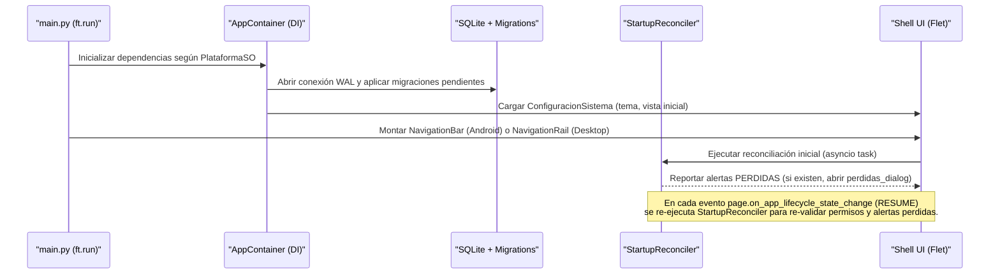

# Diseño de Arquitectura en Flet y Persistencia Local

**Proyecto:** Agenda Personal y Académica Multiplataforma  
**Stack Tecnológico:** Python >= 3.10 + **Flet 1.x** (`flet>=1.1.2`) + **SQLite 3 (WAL)** + **`flet-notifications`**  
**Plataformas Objetivo:** Android, Windows y Linux  
**Versión:** 1.0  
**Fecha:** 23 de noviembre de 2026  
**Referencias:**  
* Esquema SQL Inicial: [`docs/diseno/esquema_inicial.sql`](./esquema_inicial.sql)  
* Diseño del Motor de Notificaciones: [`docs/diseno/diseno_motor_notificaciones.md`](./diseno_motor_notificaciones.md)  
* Modelo de Dominio y Datos: [`docs/diseno/diseno_y_modelado_datos.md`](./diseno_y_modelado_datos.md)

---

## 1. Estilo Arquitectónico: Capas + Puertos y Adaptadores

Para cumplir con **`RNF-01`** (Flet obligatorio), **`RNF-03`** (desacoplamiento preparado para sincronización futura), **`RNF-05`** (degradación elegante por SO) y **`RNF-10`** (pruebas unitarias de reglas de negocio sin levantar entorno gráfico), la aplicación adopta una **Arquitectura Hexagonal / Limpia (Puertos y Adaptadores)** dividida en 4 capas estrictas:

```mermaid
flowchart TD
    subgraph Pres ["4. Capa de Presentacion (Flet 1.x UI)"]
        UI["Vistas Flet (Agenda, Tareas, Contactos, Ajustes)\nComponentes de Calendario y Dialogos"]
        SHELL["Shell Responsivo (NavigationBar Android / NavigationRail Desktop)"]
    end

    subgraph App ["2. Capa de Aplicacion (Casos de Uso y Puertos)"]
        SVC["Servicios (Eventos, Tareas, Contactos, Categorias, Ajustes)"]
        MN["MotorNotificaciones + StartupReconciler"]
        PORTS["Puertos <<Protocol>>\n(IRepositorios, IAdaptadorNotificaciones, ILanzadorURI)"]
    end

    subgraph Dom ["1. Capa de Dominio (Python Puro — Cero Dependencias)"]
        ENT["Entidades (UUIDv4, UTC) y Enumeraciones"]
        RULES["Reglas de Negocio Puras\n(Anti-solapamiento RN-11, Recurrencia, Validacion RN-01/RN-03)"]
    end

    subgraph Infra ["3. Capa de Infraestructura (Adaptadores Concretos)"]
        SQL["RepositorioSQLite (Modo WAL + Migraciones)"]
        NOTIF["Adaptadores Notificaciones\n(Android / Windows / Linux + Worker systemd)"]
        PLAT["Adaptadores SO (Detector Plataforma + mailto:/tel:)"]
        SYNC["Extension Futura: Adaptador de Sincronizacion"]
    end

    Pres --> App
    App --> Dom
    Infra -.->|"implementa"| PORTS
    Infra --> Dom
    App --> PORTS
```



### Regla de Dependencia
* **`domain/`** no importa **nada** de `flet`, `sqlite3`, `flet_notifications` ni librerías del SO. Toda la lógica de `RN-01` a `RN-14` se valida aquí y se prueba en milisegundos con `pytest`.
* **`application/`** orquesta casos de uso (`PROC-01` a `PROC-06`) y define **Puertos** (`typing.Protocol`) para persistencia, notificaciones y acciones externas.
* **`infrastructure/`** implementa esos puertos para **SQLite**, **Android/Windows/Linux** (`flet-notifications`, `desktop-notifier`, `UrlLauncher`) y expone el worker ligero de Linux.
* **`presentation/`** contiene exclusivamente componentes Flet 1.x, manejo de estado visual y navegación responsiva; delega toda acción de negocio a los servicios de `application/`.

---

## 2. Estructura Propuesta de Carpetas (`src/` y `tests/`)

Alineada con la configuración existente en [`pyproject.toml`](../../pyproject.toml) (`[tool.flet.app] path = "src"`, `pythonpath = ["src"]`, `testpaths = ["tests"]`):

```text
Agenda-Personal/
├── docs/
│   ├── propuesta/
│   ├── ing_requerimientos/
│   └── diseno/
│       ├── diseno_y_modelado_datos.md
│       ├── diagrama_clases.svg
│       ├── diagrama_entidad_relacion.svg
│       ├── diseno_motor_notificaciones.md
│       ├── arquitectura_flet.md
│       └── esquema_inicial.sql
├── src/
│   ├── main.py                                  # Punto de entrada mínimo: ft.run(main)
│   ├── assets/
│   │   └── icon.svg
│   └── agenda_app/
│       ├── __init__.py
│       ├── container.py                         # Composition Root (Inyección de Dependencias)
│       │
│       ├── domain/                              # [CAPA 1] Python puro (sin Flet ni SQLite)
│       │   ├── enums.py                         # TipoFrecuencia, EstadoTarea, EstadoRecordatorio, etc.
│       │   ├── exceptions.py                    # ChoqueEventosError, RangoTemporalInvalidoError, etc.
│       │   ├── entities/
│       │   │   ├── base.py                      # EntidadBase (UUIDv4, created_at, updated_at)
│       │   │   ├── evento.py                    # Evento + ReglaRecurrencia
│       │   │   ├── tarea.py                     # Tarea (completar, reactivar, reprogramar)
│       │   │   ├── recordatorio.py              # Recordatorio (XOR, 0..10080 min, estados)
│       │   │   ├── contacto.py                  # Contacto (URIs mailto/tel según PlataformaSO)
│       │   │   ├── categoria.py                 # Categoria + Subcategoria (2 niveles)
│       │   │   └── configuracion.py             # ConfiguracionSistema (singleton Ajustes)
│       │   └── rules/
│       │       ├── solapamiento.py              # Detección estricta de choque (incl. recurrentes RN-11)
│       │       ├── recurrencia.py               # Expansión de ocurrencias en rango temporal
│       │       └── recordatorio_rules.py        # Validación rango <= 7 días y fecha futura (RN-03)
│       │
│       ├── application/                         # [CAPA 2] Casos de Uso y Puertos
│       │   ├── dto.py                           # Dataclasses de entrada/salida para formularios
│       │   ├── ports/
│       │   │   ├── repositorios.py              # Protocols: IRepositorioEventos, Tareas, Recordatorios...
│       │   │   ├── notificaciones.py            # Protocol: IAdaptadorNotificaciones
│       │   │   ├── acciones_externas.py         # Protocol: ILanzadorAccionesExternas
│       │   │   └── reloj.py                     # Protocol: IReloj (facilita testing temporal determinista)
│       │   └── services/
│       │       ├── servicio_eventos.py          # PROC-01 y PROC-02
│       │       ├── servicio_tareas.py           # PROC-04 (cancelación al completar y reactivación)
│       │       ├── servicio_contactos.py        # PROC-05 (vinculación, desvinculación, acciones SO)
│       │       ├── servicio_categorias.py       # PROC-06 (gestión rápida 2 niveles)
│       │       ├── servicio_ajustes.py          # PROC-06 (lectura/guardado y defaults RN-14)
│       │       ├── motor_notificaciones.py      # PROC-03 (orquestación unificada + snooze)
│       │       └── startup_reconciler.py        # Barrido de perdidas (RN-05) y reconciliación al iniciar
│       │
│       ├── infrastructure/                      # [CAPA 3] Implementaciones Concretas
│       │   ├── paths.py                         # Resolución unificada de ruta DB en Android/Win/Linux
│       │   ├── clock.py                         # RelojSistemaUTC
│       │   ├── persistence/
│       │   │   └── sqlite/
│       │   │       ├── database.py              # Conexión WAL, foreign_keys=ON, busy_timeout
│       │   │       ├── migrations.py            # Ejecutor versionado de migraciones SQL
│       │   │       ├── sql/
│       │   │       │   └── 001_initial.sql      # Esquema inicial (copia productiva de esquema_inicial.sql)
│       │   │       ├── repo_eventos.py
│       │   │       ├── repo_tareas.py
│       │   │       ├── repo_recordatorios.py
│       │   │       ├── repo_contactos.py
│       │   │       ├── repo_categorias.py
│       │   │       └── repo_ajustes.py
│       │   ├── notifications/
│       │   │   ├── factory.py                   # Selecciona adaptador según plataforma
│       │   │   ├── adaptador_android.py         # flet-notifications + AlarmManager exacto/inexacto
│       │   │   ├── adaptador_windows.py         # flet-notifications one-off + cancel individual
│       │   │   ├── adaptador_linux.py           # Planificador asyncio + flet-notifications.show()
│       │   │   └── linux_worker.py              # Demonio ligero opcional para systemd --user (D-Bus)
│       │   ├── platform/
│       │   │   ├── detector_so.py               # Detecta ANDROID / WINDOWS / LINUX desde Flet/sys
│       │   │   └── lanzador_flet.py             # UrlLauncher Flet: mailto: (todos) y tel: (solo Android)
│       │   └── sync/                            # [FUTURO] Reservado para sincronización sin acoplamiento
│       │       └── README.md
│       │
│       └── presentation/                        # [CAPA 4] Interfaz Flet 1.x
│           ├── app.py                           # Configuración Page, tema, lifecycle RESUME y eventos notif.
│           ├── theme.py                         # Material 3 Light/Dark desde ConfiguracionSistema
│           ├── navigation/
│           │   └── shell.py                     # Responsivo: NavigationBar (móvil) / NavigationRail (escritorio)
│           ├── views/
│           │   ├── agenda_view.py               # Contenedor de vistas día/semana/mes/año + filtros
│           │   ├── tareas_view.py               # Módulo independiente de Tareas (RN-07)
│           │   ├── contactos_view.py            # Directorio + botones dinámicos correo/llamada (RN-08)
│           │   └── ajustes_view.py              # Configuración centralizada + diagnóstico permisos SO
│           └── components/
│               ├── calendario/
│               │   ├── vista_dia.py
│               │   ├── vista_semana.py
│               │   ├── vista_mes.py
│               │   └── vista_anio.py
│               ├── dialogs/
│               │   ├── evento_form_dialog.py    # Formulario evento + aviso choque RN-11
│               │   ├── tarea_form_dialog.py     # Formulario tarea + recordatorio
│               │   ├── contacto_form_dialog.py  # Formulario contacto
│               │   ├── categoria_quick_dialog.py# Creación rápida categoría/subcategoría en línea
│               │   └── perdidas_dialog.py       # Bandeja de notificaciones perdidas (RN-05)
│               └── widgets/
│                   ├── selector_categoria.py
│                   ├── selector_recordatorio.py # Rango 0..7 días + validación RN-03
│                   └── chip_contacto.py
└── tests/
    ├── unit/                                    # Pruebas rápidas sin Flet ni disco (mocks + IReloj fijo)
    │   ├── test_solapamiento.py                 # RN-11 (eventos normales y recurrentes)
    │   ├── test_recordatorio_rules.py           # RN-03 (límite 7 días, pasado, snooze)
    │   ├── test_ciclo_vida_tareas.py            # RN-12 (completar cancela, reactivar reprograma)
    │   └── test_contactos_plataforma.py         # RN-08 (tel: solo Android)
    ├── integration/                             # Pruebas con SQLite real en memoria (:memory:)
    │   ├── test_schema_constraints.py           # RN-01, RN-03 XOR, RN-09, RN-13 (SET NULL / sin cascada)
    │   └── test_startup_reconciler.py           # RN-05 (detección de perdidas)
    └── ui/                                      # Pruebas de interfaz con flet[test]
        └── test_app_smoke.py
```

---

## 3. Estrategia de Persistencia Multiplataforma (Ruta Unificada de SQLite)

Para que tanto la aplicación Flet como el worker residente de Linux accedan **exactamente al mismo archivo SQLite** en modo `WAL` sin rutas codificadas a mano, `infrastructure/paths.py` resuelve el directorio de datos según el SO:

| Plataforma | Ruta de Datos Persistentes (`agenda_personal.db`) | Notas Técnicas |
| :--- | :--- | :--- |
| **Linux** | `$XDG_DATA_HOME/agenda-personal/agenda_personal.db` (fallback `~/.local/share/agenda-personal/agenda_personal.db`) | Compartida de forma segura entre la app Flet y el servicio `systemd --user` usando SQLite `journal_mode = WAL` y `busy_timeout = 5000`. |
| **Windows** | `%LOCALAPPDATA%\AgendaPersonal\agenda_personal.db` | Ruta estándar de datos locales de usuario sin requerir permisos de administrador. |
| **Android** | Directorio interno privado de la app (`FLET_APP_STORAGE_DATA` provisto por el entorno Flet en Android) | Almacenamiento privado de la aplicación protegido por el sandbox de Android. |

### Configuración obligatoria en cada conexión SQLite (`database.py`)
Cada apertura de conexión ejecuta inmediatamente:
* `PRAGMA foreign_keys = ON;` (en SQLite viene desactivado por defecto; obligatorio para aplicar `RN-13` y `ON DELETE SET NULL / CASCADE`).
* `PRAGMA journal_mode = WAL;` (permite lecturas y escrituras concurrentes seguras entre Flet y el worker de Linux).
* `PRAGMA synchronous = NORMAL;` (balance óptimo entre durabilidad y rendimiento en móvil/escritorio).
* `PRAGMA busy_timeout = 5000;` (evita errores `database is locked` en escrituras simultáneas).

---

## 4. Ciclo de Vida de la Aplicación en Flet 1.x (`presentation/app.py`)



### Diseño Responsivo (`shell.py` — `RNF-08`)
* **Móvil (Android o ancho `< 720 px`):** Navegación inferior con `ft.NavigationBar` (4 destinos: *Agenda, Tareas, Contactos, Ajustes*) + `FloatingActionButton` contextual para crear evento/tarea/contacto según el módulo activo.
* **Escritorio (Windows / Linux, ancho `>= 720 px`):** Barra lateral `ft.NavigationRail` + diseño maestro-detalle aprovechando el ancho de pantalla para las vistas de calendario (semana/mes) y lista + detalle de tareas/contactos.

### Preparación Explícita para Sincronización Futura (`RN-10`, `RNF-03`)
Aunque en v1 cada dispositivo opera de forma independiente, el diseño deja listos 3 habilitadores sin coste extra hoy:
1. **Claves `UUIDv4`** en todas las tablas (cero colisiones de PK al fusionar datos de Android + PC en el futuro).
2. **Timestamps `created_at` y `updated_at` en UTC ISO-8601** (base para estrategias *Last-Write-Wins* o registro de cambios *delta sync*).
3. **Separación de Puertos (`IRepositorio*`)**: en una futura v2 se puede envolver `RepositorioSQLite` con un decorador de sincronización (*outbox/sync queue*) en `infrastructure/sync/` sin modificar `domain/` ni `presentation/`.
