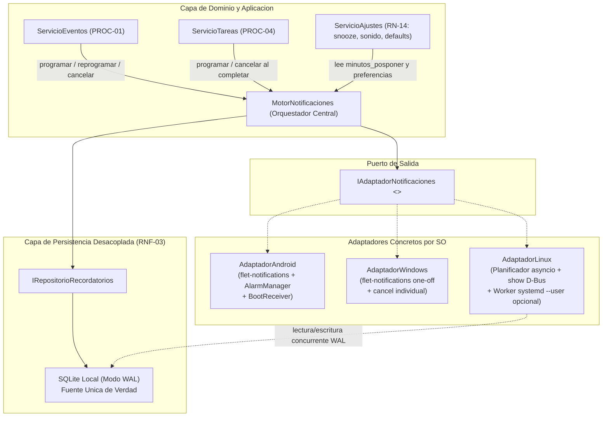
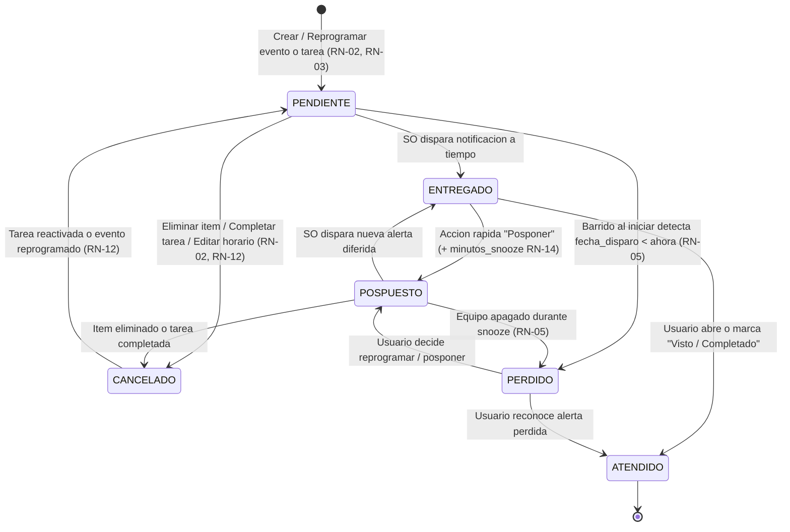

# Diseño Conceptual del Motor Unificado de Notificaciones

**Proyecto:** Agenda Personal y Académica Multiplataforma  
**Stack Tecnológico:** Python >= 3.10 + **Flet 1.x** (`flet>=1.1.2`) + **`flet-notifications`** (+ soporte D-Bus/servicio en Linux)  
**Plataformas Objetivo:** Android, Windows y Linux  
**Versión:** 1.0  
**Fecha:** 23 de noviembre de 2026  
**Referencias:**  
* Propuesta del Proyecto (Riesgo Crítico `R-01`): [`docs/propuesta/propuesta_proyecto.md`](../propuesta/propuesta_proyecto.md)  
* Especificación Formal (`PROC-03`, `RF-08`–`RF-13`, `RN-02`, `RN-03`, `RN-05`, `RN-06`, `RN-12`, `RN-14`): [`docs/ing_requerimientos/especificacion_formal_requerimientos.md`](../ing_requerimientos/especificacion_formal_requerimientos.md)  
* Modelo de Datos (`Recordatorio`, `ConfiguracionSistema`): [`docs/diseno/diseno_y_modelado_datos.md`](./diseno_y_modelado_datos.md)

---

## 1. Principios Arquitectónicos del Motor

El motor de notificaciones es la pieza de mayor riesgo técnico del proyecto (`R-01`) debido a las diferencias sustanciales entre **Android**, **Windows** y **Linux** bajo **Flet**. Para garantizar confiabilidad, mantenibilidad y cero acoplamiento, el diseño conceptual se rige por cinco principios:

1. **SQLite Local como Fuente Única de Verdad (*Single Source of Truth*):**  
   Ningún sistema operativo garantiza conservar metadatos completos ni mantener intactas las alarmas ante reinicios, revocación de permisos o ahorradores de batería. Por ello, **todos los recordatorios viven y se rastrean en SQLite**; las colas nativas de Android, Windows y Linux actúan únicamente como *mecanismos de disparo* sincronizados desde la base local.
2. **Motor Unificado (Agnóstico del Origen):**  
   Tanto el Módulo de Agenda (`Evento`) como el Módulo de Tareas (`Tarea`) consumen la misma interfaz de dominio (`MotorNotificaciones`), diferenciando únicamente el `tipo_origen` y el `payload` (`RF-08`).
3. **Estrategia *One-Off* (Próxima Ocurrencia):**  
   Aunque el usuario defina un evento recurrente, el motor siempre programa una única notificación *one-off* para la **próxima ocurrencia válida** (`RN-03`). Al entregarse o al abrir la app, el motor calcula y programa la ocurrencia siguiente. Esto unifica el comportamiento en Android, Windows (que solo admite programación *one-off*) y Linux.
4. **Aislamiento por Puertos y Adaptadores (`RNF-03`):**  
   La lógica de negocio (validación de 7 días, cálculo de *snooze*, detección de perdidas) nunca importa APIs del SO; delega a `IAdaptadorNotificaciones`.
5. **Degradación Elegante (`RN-06`, `RNF-05`):**  
   Si una plataforma o entorno de escritorio no soporta botones interactivos, permisos de alarma exacta o ejecución en segundo plano, el motor degrada limpiamente sin lanzar excepciones fatales e informa al usuario desde Ajustes.

---

## 2. Capacidades y Restricciones Reales en Flet 1.x (`flet-notifications`)

Flet 1.x cuenta con el servicio oficial **`flet-notifications`** (puente nativo sobre `flutter_local_notifications`). Sin embargo, sus capacidades varían de forma crítica entre los tres sistemas operativos objetivo:

| Capacidad Técnica | Android (`flet-notifications`) | Windows (`flet-notifications`) | Linux (`flet-notifications` + Servicio Local) |
| :--- | :--- | :--- | :--- |
| **Notificación inmediata (`show`)** | Sí (nativa, canales Android). | Sí (*Windows Toast* WinRT). | Sí (FreeDesktop D-Bus / `libnotify`). |
| **Programación diferida nativa (`schedule`)** | **Sí**, incluso con la app cerrada y tras reinicio (con *BootReceiver*). | **Sí**, pero **solo notificaciones únicas (*one-off*)**; ignora recurrencias nativas. | **NO soportado** por `flet-notifications` (lanza `NotificationUnsupportedPlatformException`, ya que D-Bus no agenda a futuro). |
| **Precisión de disparo** | Inexacta por defecto (`INEXACT_ALLOW_WHILE_IDLE`); exacta con `EXACT_ALLOW_WHILE_IDLE` + permiso de alarmas exactas. | Programación nativa del SO (*ScheduledToastNotification*). | Depende del planificador local (`asyncio` con app abierta o servicio `systemd --user` con app cerrada). |
| **Cancelación de pendientes** | Individual (`cancel(id)`) y masiva (`cancel_all_pending()`). | **Solo individual (`cancel(id)`)**; no soporta `cancel_all_pending()`. | Gestionada directamente por nuestro planificador sobre SQLite. |
| **Consulta de pendientes (`get_pending`)** | Devuelve lista con ID y metadatos. | Devuelve IDs **sin `title`** (refuerza necesidad de SQLite como fuente de verdad). | Consultada directamente desde SQLite. |
| **Acciones rápidas (`NotificationAction`)** | **Sí.** Nota crítica: **Python NO corre en isolate de fondo**; `foreground=True` abre la app para ejecutar la acción en el acto; `foreground=False` encola el evento hasta la próxima apertura. | **Sí** (*Toast Actions*). En apps empaquetadas con `flet build windows`, pulsar una acción relanza la app para procesar `on_action`. En `flet run` solo se recibe si está abierta. | **Depende del entorno de escritorio** (GNOME/KDE suelen soportarlo; algunos servidores mínimos no). Con `flet-notifications`, el clic solo llega mientras la app está corriendo. |
| **Identificador nativo requerido** | Entero de 32 bits con signo (`int32`). | Entero de 32 bits con signo (`int32`). | Entero de 32 bits con signo (`int32`) o ID D-Bus. |

---

## 3. Arquitectura Conceptual del Motor



### Componentes clave y sus responsabilidades
* **`MotorNotificaciones`:** Orquesta las reglas de negocio `RN-02`, `RN-03`, `RN-05`, `RN-12` y `RN-14`. Calcula `fecha_disparo`, valida rango `0..10080` minutos (7 días), asigna `id_notificacion_so (int32)`, persiste estado en SQLite, invoca al adaptador correspondiente y procesa eventos `on_tap` / `on_action`.
* **Fábrica de Adaptadores (`NotificationAdapterFactory`):** Detecta `page.platform` / `sys.platform` al arrancar e instancia el adaptador adecuado (`AdaptadorAndroid`, `AdaptadorWindows` o `AdaptadorLinux`).
* **Reconciliador de Arranque (`StartupReconciler`):** Se ejecuta al abrir la app y al evento `AppLifecycleState.RESUME` para detectar alertas **perdidas** (`RN-05`) y re-sincronizar pendientes si el SO revocó permisos o perdió alarmas.

---

## 4. Máquina de Estados del Recordatorio

Cada registro de la tabla `RECORDATORIOS` atraviesa un ciclo de vida determinista que evita alertas duplicadas, fantasmas o perdidas silenciosamente:



---

## 5. Estrategia Detallada por Sistema Operativo

### 5.1 Android (Prioridad Móvil — App Cerrada y Reinicios)
* **Mecanismo:** Servicio `flet-notifications` usando `schedule(..., schedule_mode=AndroidScheduleMode.EXACT_ALLOW_WHILE_IDLE)`.
* **Permisos y Degradación:**
  1. Solicitar `POST_NOTIFICATIONS` en tiempo de ejecución (`request_permissions()`).
  2. Verificar `can_schedule_exact_alarms()`:
     * Como la aplicación es formalmente una agenda/calendario, evaluar declarar `SCHEDULE_EXACT_ALARM` (o `USE_EXACT_ALARM` si aplica a distribución personal/calendario).
     * Si el usuario no otorga permiso de alarma exacta o el SO lo revoca, **degradar automáticamente** a `INEXACT_ALLOW_WHILE_IDLE` y mostrar un aviso no bloqueante en Ajustes con botón para abrir la configuración del sistema (`request_exact_alarm_permission()`).
* **Persistencia tras reinicio:** Declarar los *broadcast receivers* de `flutter_local_notifications` (`ScheduledNotificationReceiver` y `ScheduledNotificationBootReceiver` con `BOOT_COMPLETED` / `MY_PACKAGE_REPLACED`) bajo `[tool.flet.android.receiver]` en `pyproject.toml`.
* **Diseño de Acciones Rápidas en Android (consideración crítica de Flet):**  
  Dado que en `flet-notifications` **Python no se ejecuta dentro del isolate de segundo plano de Android**:
  * Acción **`Posponer`**: configurarla con **`foreground=True`**, para que al pulsarla la app despierte y Python reprograme de inmediato la nueva alarma con el valor `minutos_posponer_defecto` de Ajustes (`RN-14`).
  * Acción **`Marcar como visto`** (o `Completar tarea`): puede configurarse con `foreground=False` (se encola y se sincroniza en SQLite en la próxima apertura) o `foreground=True` si se requiere actualización inmediata del estado.
* **Protección contra cuota de alarmas OEM (ej. límite ~500 en Samsung):**  
  El motor mantiene una **ventana deslizante de programación** en el SO (por ejemplo, registrar en Android las alertas de los próximos **30 días** o hasta un tope seguro de 200 alarmas activas), rellenándola automáticamente en cada arranque (`StartupReconciler`).

### 5.2 Windows (Escritorio — *Windows Toast* Nativo)
* **Mecanismo:** `flet-notifications` con `schedule()` en modo *one-off* (único por recordatorio).
* **Cancelación y Reprogramación:** Debido a que Windows no soporta `cancel_all_pending()`, cada reprogramación o eliminación cancela explícitamente el `id_notificacion_so` almacenado en SQLite mediante `cancel(id)`.
* **Empaquetado y Acciones Rápidas:**
  * En compilación final (`flet build windows`), las notificaciones programadas sobreviven al cierre de la ventana y pulsar una acción rápida (*Posponer* / *Ver*) relanza la app entregando `NotificationActionEvent` a `on_action`.
  * Durante desarrollo (`flet run`), las acciones rápidas funcionan mientras la app está abierta; si la app estuvo cerrada y pasó la hora, el `StartupReconciler` detecta el estado vencido al reabrir (`RN-05`).

### 5.3 Linux (Escritorio — Estrategia Híbrida de Dos Niveles)
Como `flet-notifications.schedule()` **no existe en Linux** (D-Bus no posee cola diferida nativa), el adaptador de Linux se divide en dos niveles complementarios:

1. **Nivel 1 — Con la aplicación abierta (Incluido en el núcleo):**
   * Un planificador asíncrono liviano (`asyncio.Task`) dentro del proceso Flet calcula el tiempo restante hasta el próximo recordatorio `PENDIENTE`/`POSPUESTO` en SQLite (`SELECT MIN(fecha_disparo)`).
   * Duerme eficientemente hasta ese instante (o despierta inmediatamente vía `asyncio.Event` si el usuario crea, edita o borra un recordatorio).
   * Al llegar la hora, dispara la notificación nativa vía `flet-notifications.show()` (con `NotificationAction` para *Posponer* y *Marcar visto*).
2. **Nivel 2 — Con la aplicación cerrada (Servicio residente de usuario):**
   * Un **worker ligero en Python** ejecutable como servicio de usuario (`systemd --user`, sin cargar UI de Flet) que comparte acceso a la **misma base de datos SQLite en modo `WAL`** (*Write-Ahead Logging*).
   * Utiliza `desktop-notifier` (D-Bus `org.freedesktop.Notifications`) consultando primero `get_capabilities()`:
     * Si el entorno de escritorio (GNOME, KDE, etc.) soporta `actions`, adjunta botones interactivos (*Posponer*, *Visto*) y actualiza directamente el registro en SQLite.
     * Si el entorno no soporta botones, emite la notificación estándar sin error (`RN-06`).
   * Si el usuario no instala/habilita el servicio de usuario o la PC estaba apagada, el **Nivel de Recuperación (`RN-05`)** garantiza que todas las notificaciones vencidas aparezcan como **perdidas** al abrir la app.

---

## 6. Mecanismos Transversales Clave

### 6.1 Mapeo de Identificadores (`UUID` vs. `id_notificacion_so`)
* **Problema detectado:** El dominio usa `UUIDv4` (`RN-10`), pero `flet-notifications` exige un `id: int` de **32 bits con signo** (`1` a `2,147,483,647`) en todas las plataformas.
* **Solución:**  
  Mantener `id (UUIDv4)` como PK del dominio y almacenar **`id_notificacion_so: INTEGER UNIQUE NOT NULL`** en la tabla `RECORDATORIOS` (generado de forma determinista segura o secuencial local dentro del rango `1 .. 2^31 - 1`). Así se puede cancelar o actualizar cualquier alerta nativa con precisión sin perder el `UUID` para futura sincronización.

### 6.2 Estructura del `payload`
Cada notificación transporta un `payload` JSON compacto (sin datos sensibles extensos) para enrutar `on_tap` y `on_action`:
```json
{"rid": "<uuid_recordatorio>", "tipo": "EVENTO", "item_id": "<uuid_evento>"}
```
* **`on_tap`:** Abre la vista de detalle del evento o tarea correspondiente y marca el recordatorio como `ATENDIDO`.
* **`on_action(action_id="snooze")`:** Lee `minutos_posponer_defecto` de `ConfiguracionSistema` (`RN-14`), actualiza `fecha_disparo = ahora + snooze`, cambia estado a `POSPUESTO` y reprograma la alerta en el adaptador del SO.
* **`on_action(action_id="mark_seen")` / `"complete_task"`:** Marca el recordatorio como `ATENDIDO` (y si es tarea con botón de completar, invoca `Tarea.completar()`).

### 6.3 Protocolo de Arranque y Recuperación de Perdidas (`RN-05`)
Cada vez que la aplicación inicia o regresa a primer plano (`AppLifecycleState.RESUME`), el `StartupReconciler` ejecuta 4 pasos idempotentes:

1. **Verificación de permisos del SO:** Confirma estado de notificaciones y (en Android) `can_schedule_exact_alarms()`.
2. **Detección de perdidas (`RN-05`):** Busca en SQLite todos los registros con `estado IN ('PENDIENTE', 'POSPUESTO')` y `fecha_disparo < ahora_utc`:
   * Si el evento/tarea asociado sigue vigente y no fue atendido, actualiza su estado a **`PERDIDO`**.
   * Si `mostrar_alertas_perdidas_inicio == True` en Ajustes, despliega el aviso/bandeja de notificaciones perdidas para que el usuario las reconozca o posponga.
3. **Avance de recurrencias:** Para eventos recurrentes cuya última ocurrencia ya pasó, calcula la siguiente ocurrencia futura y crea/actualiza su recordatorio *one-off*.
4. **Reconciliación con la cola nativa:** Compara los recordatorios futuros `PENDIENTE`/`POSPUESTO` dentro de la ventana activa contra el SO (especialmente importante en Android tras revocación/restauración de permisos o actualización de app) y reprograma los faltantes.

### 6.4 Validación de Disponibilidad y Rango de 7 Días (`RN-03`)
Antes de aceptar un recordatorio desde la UI de Eventos o Tareas, el motor valida en orden:
1. `0 <= antelacion_minutos <= 10080` (máximo 1 semana = 7 × 24 × 60 minutos).
2. `fecha_disparo = fecha_objetivo - timedelta(minutes=antelacion_minutos)`.
3. `fecha_disparo > ahora_utc + margen_seguridad` (ej. ≥ 5 segundos en el futuro, ya que las APIs nativas tienen precisión a nivel de segundo).
4. Capacidad/permisos de la plataforma actual (si no hay permisos concedidos, solicita permiso o informa al usuario antes de guardar como fallido).

---

## 7. Configuración Declarativa Requerida en `pyproject.toml` (Referencia para Implementación)

Cuando se pase a la fase de implementación, el empaquetado de Flet requerirá:
* Dependencia: `flet-notifications` (y opcionalmente `desktop-notifier` para el worker residente de Linux).
* Permisos Android bajo `[tool.flet.android.permission]`:
  * `android.permission.POST_NOTIFICATIONS`
  * `android.permission.RECEIVE_BOOT_COMPLETED`
  * `android.permission.SCHEDULE_EXACT_ALARM` (o `USE_EXACT_ALARM` según política de distribución)
* Receivers Android bajo `[tool.flet.android.receiver]`:
  * `com.dexterous.flutterlocalnotifications.ScheduledNotificationReceiver`
  * `com.dexterous.flutterlocalnotifications.ScheduledNotificationBootReceiver` (filtros `BOOT_COMPLETED`, `MY_PACKAGE_REPLACED`, `QUICKBOOT_POWERON`)

---

## 8. Plan de Validación Temprana (Prueba de Concepto — Mitigación de `R-01`)

Antes de construir las vistas completas de calendario, se recomienda validar 4 escenarios mínimos mediante un *PoC* aislado del motor:

| # | Prueba PoC | Plataforma | Criterio de Éxito |
| :--- | :--- | :--- | :--- |
| **PoC-1** | Programar alerta a +2 minutos, cerrar la app y esperar disparo + pulsar *Posponer*. | Android y Windows | La notificación llega con la app cerrada y *Posponer* reprograma correctamente según Ajustes. |
| **PoC-2** | Reprogramar y cancelar una notificación existente por `id_notificacion_so (int32)`. | Android, Windows, Linux | La alerta anterior no se dispara y solo suena la nueva (o ninguna al cancelar). |
| **PoC-3** | Simular equipo apagado durante la hora de disparo y abrir la app después. | Android, Windows, Linux | El `StartupReconciler` marca la alerta como `PERDIDO` y la presenta al usuario. |
| **PoC-4** | Disparo programado con app abierta (`asyncio`) y con app cerrada (worker `systemd --user` + D-Bus + SQLite WAL). | Linux | La notificación aparece en el entorno de escritorio con degradación elegante si no soporta botones. |
