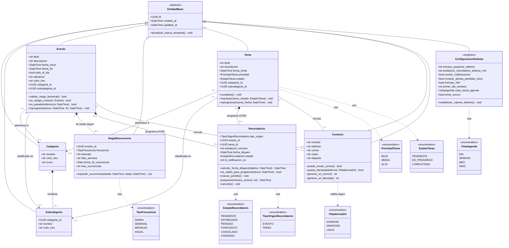
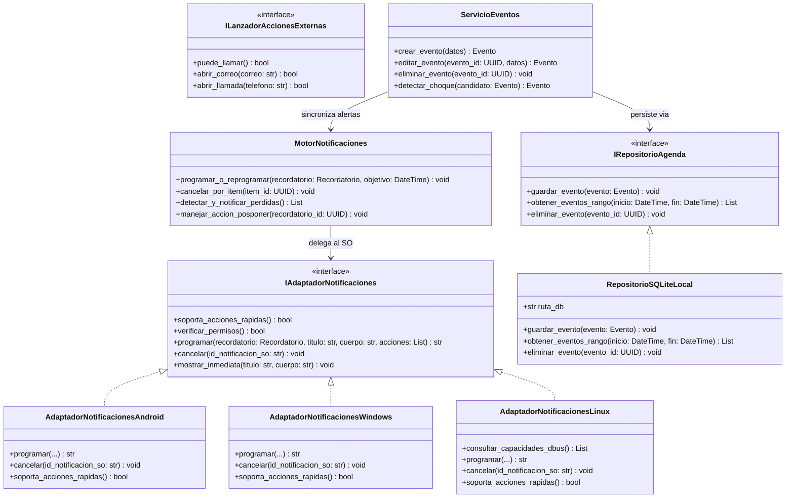
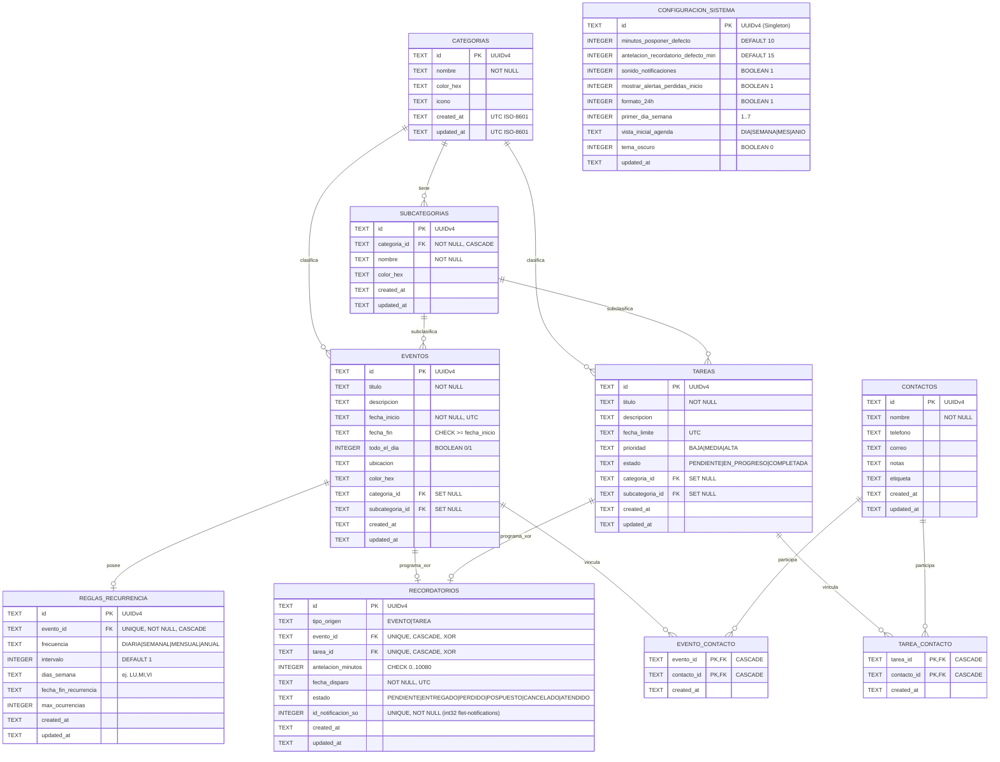

# Fase de Diseño y Modelado de Datos

**Proyecto:** Agenda Personal y Académica Multiplataforma (Flet)  
**Plataformas Objetivo:** Android, Windows y Linux  
**Versión:** 1.0  
**Fecha:** 23 de noviembre de 2026  
**Documentos Base:**  
* Propuesta del Proyecto: [`docs/propuesta/propuesta_proyecto.md`](../propuesta/propuesta_proyecto.md)  
* Especificación Formal de Requerimientos (ERS): [`docs/ing_requerimientos/especificacion_formal_requerimientos.md`](../ing_requerimientos/especificacion_formal_requerimientos.md)

**Diagramas SVG generados:**  
* Diagrama de Clases UML (Dominio): [`diagrama_clases.svg`](./diagrama_clases.svg)  
* Diagrama Entidad–Relación (Modelo de Datos): [`diagrama_entidad_relacion.svg`](./diagrama_entidad_relacion.svg)

---

## 1. Identificación de Entidades del Dominio

A partir de los procesos (`PROC-01` a `PROC-06`), requerimientos (`RF-01` a `RF-24`, `RNF-01` a `RNF-10`) y reglas de negocio (`RN-01` a `RN-14`), se identifican **9 entidades de dominio/persistencia** (más 1 superclase abstracta base y 6 enumeraciones), todas preparadas con identificadores `UUIDv4` y marcas temporales UTC (`RN-10`) para facilitar sincronización futura sin acoplamiento:

| # | Entidad | Módulo | Propósito Principal | Reglas de Negocio Clave |
| :--- | :--- | :--- | :--- | :--- |
| 0 | **`EntidadBase`** *(Abstracta)* | Transversal | Define `id (UUID)`, `created_at` y `updated_at` heredados por todas las entidades persistentes. | `RN-10`, `RNF-03` |
| 1 | **`Evento`** | Agenda | Representa un compromiso calendarizado con fecha/hora de inicio, fin opcional, indicador de todo el día, ubicación y color. | `RN-01`, `RN-04`, `RN-07`, `RN-11` |
| 2 | **`ReglaRecurrencia`** | Agenda | Define el patrón de repetición periódica (diaria, semanal, mensual o anual) asociado de forma opcional (`0..1`) a un `Evento`. | `RF-06`, `RN-11` |
| 3 | **`Tarea`** | Tareas | Representa una actividad pendiente en módulo propio independiente del calendario, con fecha límite, prioridad y ciclo de vida de estado. | `RN-07`, `RN-12` |
| 4 | **`Recordatorio`** | Notificaciones | Modela la alerta programable única (`0..1`) asociada de forma exclusiva (XOR) a un `Evento` o a una `Tarea`, controlando su estado (`PENDIENTE`, `ENTREGADO`, `PERDIDO`, `POSPUESTO`, `CANCELADO`, `ATENDIDO`). | `RN-02`, `RN-03`, `RN-05`, `RN-06`, `RN-12` |
| 5 | **`Contacto`** | Contactos | Almacena la ficha de personas personales o académicas (nombre, teléfono, correo, notas, etiqueta) y resuelve acciones externas condicionadas por SO. | `RN-08`, `RN-13` |
| 6 | **`Categoria`** | Organización | Nivel 1 de clasificación (ej. *Universidad, Personal, Trabajo*). | `RN-09`, `RN-13` |
| 7 | **`Subcategoria`** | Organización | Nivel 2 de clasificación (ej. *Cálculo, Ingeniería de Software*), siempre subordinada a una `Categoria` padre. | `RN-09`, `RN-13` |
| 8 | **`ConfiguracionSistema`** | Ajustes | Entidad *singleton* persistente con parámetros operativos globales (*snooze*, antelación por defecto, formato 12h/24h, tema, vista inicial, primer día de la semana). | `RF-23`, `RF-24`, `RN-14` |
| 9 | **`EventoContacto` / `TareaContacto`** *(Tablas asociativas)* | Relacional | Materializan las relaciones muchos a muchos (`0..*` $\leftrightarrow$ `0..*`) entre `Contacto` y `Evento`/`Tarea`, garantizando desvinculación segura sin borrado en cascada. | `RF-18`, `RF-19`, `RN-13` |

---

## 2. Matriz de Relaciones y Cardinalidades

| Entidad Origen | Relación | Cardinalidad | Entidad Destino | Tipo UML | Regla de Integridad Referencial |
| :--- | :--- | :---: | :--- | :--- | :--- |
| `Categoria` | agrupa | `1` $\longrightarrow$ `0..*` | `Subcategoria` | Composición | `ON DELETE CASCADE` sobre subcategorías hijas (los eventos/tareas pasan a *"Sin categoría"*). |
| `Evento` | clasificado en | `0..*` $\longrightarrow$ `0..1` | `Categoria` | Asociación | `ON DELETE SET NULL` (`RN-13`). |
| `Evento` | clasificado en | `0..*` $\longrightarrow$ `0..1` | `Subcategoria` | Asociación | `ON DELETE SET NULL` (`RN-13`; conserva `categoria_id` si existe). |
| `Tarea` | clasificada en | `0..*` $\longrightarrow$ `0..1` | `Categoria` | Asociación | `ON DELETE SET NULL` (`RN-13`). |
| `Tarea` | clasificada en | `0..*` $\longrightarrow$ `0..1` | `Subcategoria` | Asociación | `ON DELETE SET NULL` (`RN-13`). |
| `Evento` | posee | `1` $\longrightarrow$ `0..1` | `ReglaRecurrencia` | Composición | `ON DELETE CASCADE` (la regla no existe sin su evento). |
| `Evento` | dispara *(XOR)* | `0..1` $\longrightarrow$ `0..1` | `Recordatorio` | Composición | `ON DELETE CASCADE` + cancelación en SO (`RN-02`, `RN-03`). |
| `Tarea` | dispara *(XOR)* | `0..1` $\longrightarrow$ `0..1` | `Recordatorio` | Composición | `ON DELETE CASCADE` + cancelación en SO (`RN-02`, `RN-03`, `RN-12`). |
| `Evento` | vincula | `0..*` $\longleftrightarrow$ `0..*` | `Contacto` | Asociación N:M | Tabla `evento_contacto`; eliminar un contacto solo elimina el vínculo (`RN-13`). |
| `Tarea` | vincula | `0..*` $\longleftrightarrow$ `0..*` | `Contacto` | Asociación N:M | Tabla `tarea_contacto`; eliminar un contacto solo elimina el vínculo (`RN-13`). |

> **Restricción de Arco Exclusivo (XOR) en `Recordatorio`:** Todo registro de `Recordatorio` debe referenciar exactamente a **un `Evento` o a una `Tarea`**, nunca a ambos ni a ninguno (`(evento_id IS NOT NULL) XOR (tarea_id IS NOT NULL)`), garantizando a su vez unicidad (`UNIQUE`) por ítem para cumplir `RN-03` (máximo 1 recordatorio activo en v1).

---

## 3. Diagrama de Clases UML — Modelo de Dominio (Mermaid)

> Versión gráfica independiente en sintaxis SVG: [`docs/diseno/diagrama_clases.svg`](./diagrama_clases.svg)

---

## 4. Diagrama de Clases — Capa de Servicios y Adaptadores Multiplataforma (Desacoplamiento `RNF-03`)

Para cumplir con **Flet** (`RNF-01`), las APIs nativas de **Android, Windows y Linux** (`RF-10`, `RF-12`, `RF-20`) y el desacoplamiento preparado para sincronización futura (`RN-10`, `RNF-03`), se definen interfaces (*puertos*) separadas de las implementaciones concretas (*adaptadores*):

---

## 5. Modelo Entidad–Relación / Modelo de Datos Relacional (Mermaid)

> Versión gráfica independiente en sintaxis SVG: [`docs/diseno/diagrama_entidad_relacion.svg`](./diagrama_entidad_relacion.svg)

---

## 6. Diccionario de Restricciones de Integridad en Base de Datos (SQLite)

| Tabla | Restricción / Invariante | Regla Cubierta |
| :--- | :--- | :--- |
| Todas | Clave primaria `id TEXT PRIMARY KEY` (`UUIDv4`) y marcas `created_at`/`updated_at` en formato UTC ISO-8601. | `RN-10`, `RNF-03` |
| `EVENTOS` | `CHECK (todo_el_dia = 1 OR fecha_fin IS NULL OR fecha_fin >= fecha_inicio)` | `RN-01` |
| `EVENTOS` | Índice sobre `(fecha_inicio, fecha_fin)` para acelerar la validación estricta anti-solapamiento (`inicio_A < fin_B AND fin_A > inicio_B`). | `RN-11`, `RNF-07` |
| `RECORDATORIOS` | `CHECK (antelacion_minutos >= 0 AND antelacion_minutos <= 10080)` (máximo 7 días = 10,080 minutos). | `RN-03` |
| `RECORDATORIOS` | `CHECK ((evento_id IS NOT NULL AND tarea_id IS NULL AND tipo_origen = 'EVENTO') OR (tarea_id IS NOT NULL AND evento_id IS NULL AND tipo_origen = 'TAREA'))` (arco exclusivo XOR) + `UNIQUE(evento_id)` y `UNIQUE(tarea_id)`. | `RN-03` |
| `RECORDATORIOS` | Índice sobre `(estado, fecha_disparo)` para el barrido rápido de notificaciones `PENDIENTE` vencidas al iniciar (`PERDIDO`). | `RN-05`, `RNF-04` |
| `EVENTO_CONTACTO` / `TAREA_CONTACTO` | `ON DELETE CASCADE` únicamente en la tabla intermedia: eliminar un contacto borra sus vínculos pero **nunca** elimina los eventos ni tareas asociados. | `RN-13` |
| `EVENTOS` / `TAREAS` | `FOREIGN KEY (categoria_id) ... ON DELETE SET NULL` y `FOREIGN KEY (subcategoria_id) ... ON DELETE SET NULL`. | `RN-13` |
| `SUBCATEGORIAS` | Relación directa `categoria_id NOT NULL` hacia `CATEGORIAS`, impidiendo estructuralmente crear más de 2 niveles de anidamiento. | `RN-09` |
