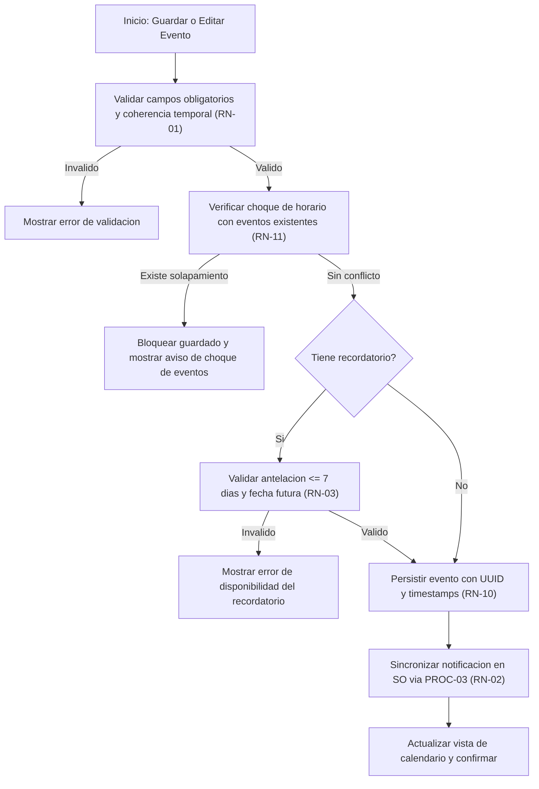
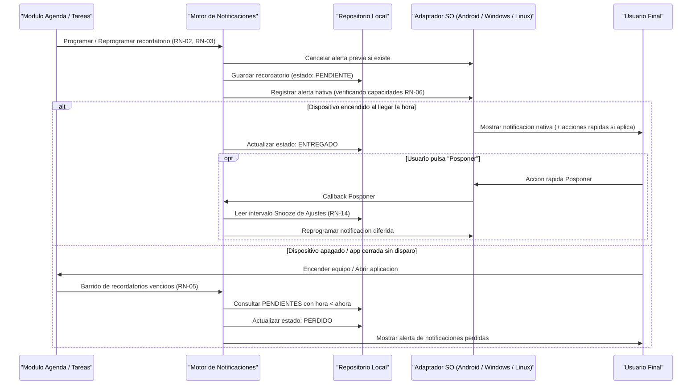

# Especificación Formal de Requerimientos (ERS)

**Proyecto:** Agenda Personal y Académica Multiplataforma  
**Stack Tecnológico:** Python + Flet  
**Plataformas Objetivo:** Android, Windows y Linux  
**Versión:** 1.0 (Formalizada tras Elicitación Rondas 1 y 2)  
**Fecha:** 23 de noviembre de 2026  
**Documentos Base:**  
* Propuesta del Proyecto: [`docs/propuesta/propuesta_proyecto.md`](../propuesta/propuesta_proyecto.md)  
* Recolección de Datos y Entrevistas: [`docs/ing_requerimientos/ingenieria_requerimientos.md`](./ingenieria_requerimientos.md)

---

## 1. Descripción Formal de Procesos

A continuación se modelan y especifican los **6 procesos centrales** del sistema, describiendo sus actores, disparadores, entradas, flujo principal, flujos alternos/excepciones, salidas y trazabilidad hacia reglas de negocio.

---

### PROC-01: Gestión de Eventos (Creación, Modificación y Eliminación)
* **Objetivo:** Registrar, actualizar o eliminar eventos en la agenda garantizando integridad temporal, ausencia de solapamientos y sincronía con el motor de notificaciones.
* **Actor:** Usuario Final.
* **Disparador:** El usuario solicita crear un evento nuevo, editar uno existente o eliminarlo desde cualquiera de las vistas de agenda.
* **Entradas:** Título *(obligatorio)*, fecha/hora de inicio *(obligatorio)*, indicador de todo el día, fecha/hora de fin *(opcional)*, descripción, ubicación, regla de recurrencia, categoría/subcategoría, color, contactos vinculados, configuración de recordatorio.
* **Salidas:** Evento persistido/actualizado/eliminado en almacenamiento local, vista de agenda actualizada, recordatorio registrado/reprogramado/cancelado en la API del SO o aviso de validación/choque.
* **Reglas y Requerimientos Asociados:** `RF-01` a `RF-06`, `RF-10`, `RN-01`, `RN-02`, `RN-03`, `RN-10`, `RN-11`.

**Flujo Principal (Creación / Edición):**
1. El usuario ingresa o modifica los datos del evento en el formulario.
2. El sistema valida los campos obligatorios (título y fecha/hora de inicio) y verifica la coherencia temporal (`RN-01`: si no es todo el día y posee hora de fin, `fecha_fin >= fecha_inicio`).
3. El sistema consulta los eventos existentes (incluyendo instancias generadas por eventos recurrentes) para verificar si existe colisión en el rango horario (`RN-11`).
4. Si el usuario configuró un recordatorio, el sistema valida que la antelación esté entre `0` y `7 días` y que la fecha/hora de disparo resultante sea futura (`RN-03`).
5. El sistema persiste el evento con `UUID` y marca temporal `updated_at` (`RN-10`).
6. Si es una modificación de fecha/hora o recordatorio, el sistema invoca a `PROC-03` para cancelar la notificación anterior y programar la nueva (`RN-02`).
7. El sistema actualiza la vista activa del calendario y confirma la operación al usuario.

**Flujos Alternos y Excepciones:**
* **FA-01 (Choque de eventos — `RN-11`):** En el paso 3, si se detecta solapamiento con otro evento existente, el sistema **bloquea el guardado**, muestra un aviso explícito de choque indicando el evento en conflicto y permite al usuario ajustar el horario.
* **FA-02 (Incoherencia temporal — `RN-01`):** En el paso 2, si `fecha_fin < fecha_inicio`, el sistema rechaza el guardado e indica el error en el campo correspondiente.
* **FA-03 (Recordatorio inválido — `RN-03`):** En el paso 4, si el recordatorio supera 1 semana de antelación o cae en el pasado, el sistema informa al usuario para corregir el tiempo previo.
* **FA-04 (Eliminación de evento):** El usuario solicita eliminar un evento $\rightarrow$ el sistema solicita confirmación $\rightarrow$ cancela cualquier notificación asociada en `PROC-03` (`RN-02`) $\rightarrow$ elimina el evento y refresca la vista.

---

### PROC-02: Consulta de Agenda, Vistas Temporales e Historial
* **Objetivo:** Permitir al usuario visualizar su itinerario pasado y futuro en múltiples escalas temporales y con filtros por categoría o subcategoría.
* **Actor:** Usuario Final.
* **Disparador:** Apertura del módulo de Agenda, cambio de vista temporal, navegación entre fechas o aplicación de filtros.
* **Entradas:** Tipo de vista (*Día, Semana, Mes, Año, Calendario*), fecha de referencia, filtro opcional de categoría/subcategoría.
* **Salidas:** Renderizado de eventos vigentes y pasados correspondientes al período consultado.
* **Reglas y Requerimientos Asociados:** `RF-04`, `RF-05`, `RN-04`, `RN-07`, `RN-14`.

**Flujo Principal:**
1. El usuario accede al módulo de Agenda; el sistema carga la vista predeterminada y el primer día de la semana configurados en Ajustes (`RN-14`).
2. El sistema recupera los eventos (puntuales e instancias de recurrentes) correspondientes al rango visible, excluyendo tareas del Módulo de Tareas (`RN-07`).
3. El usuario puede alternar libremente entre vista de **Día, Semana, Mes, Año** y la **vista estilo calendario**, así como desplazarse a fechas pasadas para consultar el historial (`RN-04`).
4. Opcionalmente, el usuario filtra por categoría o subcategoría o selecciona un evento para ver su detalle (incluyendo contactos vinculados).

---

### PROC-03: Motor Unificado de Notificaciones Multiplataforma (Programación, Disparo y Recuperación)
* **Objetivo:** Programar, cancelar, disparar y recuperar notificaciones locales tanto de **Eventos** como de **Tareas**, adaptándose dinámicamente a las APIs nativas de Android, Windows y Linux.
* **Actores:** Sistema (servicio local / adaptador de SO) y Usuario Final.
* **Disparadores:**
  1. Invocación desde `PROC-01` (Eventos) o `PROC-04` (Tareas).
  2. Cumplimiento de la hora programada de un recordatorio.
  3. Inicio de la aplicación o reanudación del dispositivo tras estar apagado.
  4. Interacción del usuario con una acción rápida en la notificación.
* **Entradas:** `item_id` (UUID), tipo de origen (*Evento* o *Tarea*), título, mensaje, fecha/hora de disparo, configuración de Ajustes (`snooze_minutes`, sonido), capacidades de la plataforma actual.
* **Salidas:** Notificación nativa entregada por el SO, notificación reprogramada (si se pospone), o bandeja/aviso de notificaciones perdidas.
* **Reglas y Requerimientos Asociados:** `RF-07` a `RF-12`, `RN-02`, `RN-03`, `RN-05`, `RN-06`, `RN-12`, `RN-14`.

**Flujo Principal — A (Programación / Reprogramación):**
1. El motor recibe la solicitud de programar un recordatorio único para un evento o tarea.
2. Verifica si existía una notificación previa registrada para el mismo `item_id`; de existir, solicita su cancelación al adaptador del SO (`RN-02`).
3. Valida la fecha de disparo (`<= 7 días` antes del objetivo y en el futuro) y verifica disponibilidad en la API del SO (`RN-03`).
4. Persiste el estado del recordatorio (`PENDIENTE`) en el repositorio local y delega la programación al adaptador de plataforma:
   * **Android:** Canal de notificación + `AlarmManager` / permisos nativos.
   * **Windows:** *Windows Toast Notifications* (WinRT) + servicio residente.
   * **Linux:** D-Bus (`org.freedesktop.Notifications`) / `libnotify` + servicio de usuario.

**Flujo Principal — B (Disparo y Acciones Rápidas):**
1. Al cumplirse la hora programada, el adaptador consulta las capacidades de la API del SO (`RN-06`).
2. Si el SO soporta acciones rápidas, emite la notificación con botones (ej. *"Posponer"* y *"Marcar como visto"* / *"Completar"*); en caso contrario, emite notificación estándar sin error.
3. Marca el recordatorio como `ENTREGADO`.
4. Si el usuario pulsa *"Posponer"*, el motor lee el intervalo configurado en Ajustes (`RN-14`) y programa una nueva alerta diferida.

**Flujo Alterno — C (Recuperación de Notificaciones Perdidas — `RN-05`):**
1. Al arrancar el sistema o abrir la aplicación, el motor ejecuta un barrido buscando recordatorios en estado `PENDIENTE` cuya hora de disparo ya transcurrió (`hora_disparo < ahora`).
2. Marca dichos recordatorios como `PERDIDO` y los presenta de forma destacada al usuario (mediante notificación agrupada o panel de alertas vencidas) hasta que el usuario los reconozca o reprograme.

---

### PROC-04: Gestión del Ciclo de Vida de Tareas
* **Objetivo:** Administrar las actividades pendientes en un módulo dedicado, coordinando automáticamente sus recordatorios ante cambios de estado o reprogramaciones.
* **Actor:** Usuario Final.
* **Disparador:** El usuario crea, edita, cambia de estado, reprograma o elimina una tarea dentro del Módulo de Tareas.
* **Entradas:** Título, descripción, fecha límite, prioridad, estado (*Pendiente, En progreso, Completada*), categoría/subcategoría, contactos vinculados, recordatorio.
* **Salidas:** Tarea actualizada en el Módulo de Tareas y sincronización del recordatorio en `PROC-03`.
* **Reglas y Requerimientos Asociados:** `RF-13` a `RF-16`, `RN-02`, `RN-03`, `RN-07`, `RN-10`, `RN-12`.

**Flujo Principal:**
1. El usuario abre el Módulo de Tareas (independiente del calendario, `RN-07`).
2. Crea o edita una tarea con sus atributos y, opcionalmente, configura un recordatorio (hasta 1 semana antes de la fecha límite, `RN-03`).
3. El sistema persiste la tarea con `UUID` y `updated_at` (`RN-10`) y delega la programación del recordatorio a `PROC-03`.
4. Cuando el usuario marca la tarea como **Completada**, el sistema actualiza el estado y solicita a `PROC-03` la **cancelación automática** del recordatorio pendiente (`RN-12`).

**Flujos Alternos:**
* **FA-01 (Reactivación o reprogramación — `RN-12`):** Si una tarea previamente completada vuelve a *Pendiente* o *En progreso*, o si se modifica su fecha límite/hora, el sistema reevalúa su recordatorio contra `RN-03` y lo vuelve a establecer en `PROC-03`.
* **FA-02 (Eliminación):** Al eliminar una tarea, se cancela cualquier recordatorio pendiente (`RN-02`).

---

### PROC-05: Gestión de Contactos, Vinculación y Acciones Externas
* **Objetivo:** Mantener el directorio de contactos personales y académicos, permitir su asociación con eventos/tareas y delegar acciones de comunicación a las apps nativas del SO.
* **Actor:** Usuario Final.
* **Disparador:** Creación/edición/eliminación de un contacto, vinculación desde un evento/tarea o clic en acción de correo/llamada.
* **Entradas:** Nombre, teléfono, correo electrónico, notas, categoría/etiqueta; solicitud de acción externa (*Llamar* o *Enviar correo*).
* **Salidas:** Contacto persistido/actualizado/eliminado, referencias desvinculadas si se elimina, o apertura de app externa del SO.
* **Reglas y Requerimientos Asociados:** `RF-17` a `RF-20`, `RN-08`, `RN-10`, `RN-13`.

**Flujo Principal:**
1. El usuario gestiona contactos (crear, consultar, buscar, editar, eliminar) registrando sus datos y categoría (*Profesor, Compañero, Familia, Trabajo*, etc.).
2. Al abrir la ficha de un contacto (directamente o desde un evento/tarea vinculado), el sistema detecta la plataforma en ejecución (`RN-08`):
   * Si existe correo electrónico: habilita el botón **Enviar correo** en **Android, Windows y Linux** (`mailto:<correo>`).
   * Si existe teléfono **y** la plataforma es **Android**: habilita el botón **Llamar** (`tel:<telefono>`). En **Windows y Linux** esta acción se oculta o deshabilita.
3. Al pulsar una acción habilitada, el sistema delega el URI al sistema operativo para abrir el gestor externo correspondiente.

**Flujo Alterno:**
* **FA-01 (Eliminación de contacto vinculado — `RN-13`):** Si el contacto a eliminar está asociado a uno o más eventos o tareas, el sistema elimina únicamente la referencia de vinculación y conserva intactos dichos eventos y tareas.

---

### PROC-06: Gestión Rápida de Categorías, Subcategorías y Ajustes del Sistema
* **Objetivo:** Permitir la organización flexible en dos niveles (categorías y subcategorías) y la personalización centralizada del comportamiento de la aplicación.
* **Actor:** Usuario Final.
* **Disparador:** Creación/edición/eliminación de categorías/subcategorías (desde su gestor o en línea en formularios) o modificación de preferencias en Ajustes.
* **Entradas:** Nombre, color, categoría padre (para subcategorías); parámetros de configuración (*snooze*, antelación por defecto, tema, formato horario, primer día de la semana, vista inicial, preferencias de notificación).
* **Salidas:** Catálogo actualizado y configuración global aplicada en tiempo real.
* **Reglas y Requerimientos Asociados:** `RF-21` a `RF-24`, `RN-09`, `RN-13`, `RN-14`.

**Flujo Principal:**
1. El usuario crea o edita una categoría principal o una subcategoría asociada a un padre (`RN-09`), pudiendo hacerlo directamente desde los formularios de Eventos o Tareas.
2. Si elimina una categoría o subcategoría en uso, los eventos y tareas asociados se conservan reasignándose a *"Sin categoría"* o a la categoría padre según corresponda (`RN-13`).
3. En la sección de **Ajustes**, el usuario modifica las preferencias globales (`RN-14`); el sistema las persiste localmente y las aplica de inmediato a la interfaz y al motor de notificaciones.

---

## 2. Tabla Formal de Requerimientos Funcionales (RF)

Priorización bajo escala **MoSCoW**: **Debe** (Crítico/MVP), **Debería** (Importante), **Podría** (Deseable).

| ID | Módulo | Nombre | Descripción Formal | Prioridad | Criterio de Aceptación | Trazabilidad |
| :--- | :--- | :--- | :--- | :--- | :--- | :--- |
| **RF-01** | Agenda | Creación de eventos | El sistema debe permitir crear eventos con título y fecha/hora de inicio obligatorios, y campos opcionales de fecha/hora de fin, descripción, ubicación, categoría/subcategoría, color, contactos vinculados y recordatorio. | Debe | Se guarda el evento con `UUID` y aparece en la agenda si supera las validaciones temporales y de solapamiento. | `PROC-01`, `RN-01`, `RN-10`, `RN-11` |
| **RF-02** | Agenda | Modificación y reprogramación de eventos | El sistema debe permitir editar cualquier atributo de un evento existente, incluyendo la reprogramación de su fecha y hora. | Debe | Los cambios se reflejan en todas las vistas y, si cambió la fecha/hora o recordatorio, se reprograma la notificación en el SO. | `PROC-01`, `RN-01`, `RN-02`, `RN-11` |
| **RF-03** | Agenda | Eliminación de eventos | El sistema debe permitir eliminar eventos existentes previa confirmación del usuario. | Debe | El evento desaparece de las vistas y su notificación pendiente queda cancelada en el SO. | `PROC-01`, `RN-02` |
| **RF-04** | Agenda | Consulta de eventos futuros e historial | El sistema debe permitir visualizar tanto eventos futuros como eventos pasados sin eliminarlos automáticamente al vencer. | Debe | Al navegar a fechas pasadas se muestran los eventos históricos con todos sus datos intactos. | `PROC-02`, `RN-04` |
| **RF-05** | Agenda | Vistas temporales y vista calendario | El sistema debe ofrecer vistas de eventos en formatos de **día, semana, mes y año**, incorporando una representación gráfica estilo calendario. | Debe | El usuario puede cambiar entre las 4 escalas temporales y ver los eventos ubicados en sus fechas correctas. | `PROC-02`, `RN-07`, `RN-14` |
| **RF-06** | Agenda | Eventos de todo el día y recurrentes | El sistema debe soportar eventos de duración "todo el día" y eventos recurrentes (periodicidad diaria, semanal, mensual o anual). | Debería | Un evento recurrente genera y despliega sus ocurrencias en las vistas sin duplicar registros manuales. | `PROC-01`, `PROC-02`, `RN-11` |
| **RF-07** | Agenda | Validación anti-solapamiento | El sistema debe impedir el registro o edición de eventos cuyo rango horario se solape con otro evento existente, desplegando un aviso de choque de eventos. | Debe | Al ingresar un horario en conflicto, el guardado se bloquea y se muestra qué evento genera el choque. | `PROC-01`, `RN-11` |
| **RF-08** | Notificaciones | Motor unificado Agenda–Tareas | El sistema debe proveer un motor único de notificaciones que gestione los recordatorios tanto de eventos como de tareas. | Debe | Tanto un evento como una tarea invocan la misma interfaz de programación, cancelación y entrega de alertas. | `PROC-03`, `RN-02` |
| **RF-09** | Notificaciones | Configuración de recordatorio con rango amplio | El sistema debe permitir programar **1 recordatorio** por evento o tarea: a la hora exacta, con antelación predefinida o tiempo personalizado de hasta **1 semana (7 días) antes**, verificando disponibilidad temporal. | Debe | Se aceptan recordatorios entre 0 min y 7 días antes si resultan en un instante futuro; los inválidos son rechazados con mensaje claro. | `PROC-03`, `RN-03` |
| **RF-10** | Notificaciones | Integración nativa Android, Windows y Linux | El sistema debe entregar notificaciones mediante adaptadores específicos para las APIs nativas de Android, Windows y Linux. | Debe | La notificación se visualiza en el centro de notificaciones nativo del sistema operativo en las tres plataformas objetivo. | `PROC-03`, `RN-06` |
| **RF-11** | Notificaciones | Detección de notificaciones perdidas | El sistema debe detectar al iniciarse o reanudarse cualquier recordatorio no entregado por apagado/inactividad del equipo y mostrarlo como **notificación perdida/vencida**. | Debe | Tras simular equipo apagado durante la hora programada, al abrir la app aparece el aviso de notificación perdida. | `PROC-03`, `RN-05` |
| **RF-12** | Notificaciones | Acciones rápidas condicionadas por SO | El sistema debe incluir acciones rápidas en la notificación (como *Posponer* según Ajustes y *Marcar como visto/completado*) cuando la API del SO lo soporte. | Debería | En entornos compatibles los botones ejecutan su acción; en entornos sin soporte se muestra notificación estándar sin fallo. | `PROC-03`, `RN-06`, `RN-14` |
| **RF-13** | Notificaciones | Sincronía y reprogramación automática | El sistema debe cancelar la notificación previa y registrar una nueva ante cambios de fecha/hora o reactivaciones, y cancelarla al eliminar el ítem o completar una tarea. | Debe | Ninguna notificación obsoleta se dispara tras reprogramar, eliminar un ítem o completar una tarea. | `PROC-01`, `PROC-03`, `PROC-04`, `RN-02`, `RN-12` |
| **RF-14** | Tareas | Módulo independiente de Tareas | El sistema debe presentar las tareas en su propio módulo/vista, separado de las vistas del calendario de la agenda. | Debe | Las tareas solo se administran y listan en el Módulo de Tareas y no aparecen mezcladas dentro del calendario. | `PROC-04`, `RN-07` |
| **RF-15** | Tareas | CRUD completo de tareas | El sistema debe permitir crear, consultar, modificar y eliminar tareas registrando título, descripción, fecha límite, prioridad, estado (*Pendiente, En progreso, Completada*), categoría/subcategoría, contactos vinculados y recordatorio. | Debe | Todas las operaciones CRUD persisten correctamente y reflejan cambios de estado y filtros por prioridad/estado/categoría. | `PROC-04`, `RN-10` |
| **RF-16** | Tareas | Gestión de estado y recordatorio en tareas | El sistema debe cancelar el recordatorio de una tarea al marcarla como *Completada* y volver a evaluarlo/establecerlo si la tarea se reactiva o se modifica su fecha límite. | Debe | Completar cancela la alerta; reactivar o cambiar la fecha límite vuelve a programar el recordatorio si es válido. | `PROC-04`, `RN-02`, `RN-03`, `RN-12` |
| **RF-17** | Contactos | CRUD y categorización de contactos | El sistema debe permitir crear, consultar, buscar, modificar y eliminar contactos con nombre, teléfono, correo electrónico, notas y categoría/etiqueta. | Debe | El directorio permite alta, búsqueda rápida, edición y baja persistente de fichas de contacto. | `PROC-05`, `RN-10` |
| **RF-18** | Contactos | Vinculación de contactos con eventos y tareas | El sistema debe permitir asociar uno o más contactos a eventos de la agenda y a tareas, y acceder a su ficha desde dichos ítems. | Debe | Desde el detalle de un evento o tarea se visualizan los contactos vinculados y se puede abrir su ficha. | `PROC-01`, `PROC-04`, `PROC-05` |
| **RF-19** | Contactos | Desvinculación segura al eliminar | El sistema debe conservar intactos los eventos y tareas cuando se elimina un contacto vinculado, removiendo únicamente la asociación. | Debe | Al borrar un contacto asociado a un evento y una tarea, ambos registros permanecen accesibles sin el contacto eliminado. | `PROC-05`, `RN-13` |
| **RF-20** | Contactos | Acciones externas por plataforma (`mailto:` / `tel:`) | El sistema debe permitir abrir el gestor de correo externo (`mailto:`) en Android, Windows y Linux, y la app de llamadas (`tel:`) **exclusivamente en Android**, ocultando o deshabilitando llamadas en escritorio. | Debe | En Android funcionan correo y llamada; en Windows/Linux funciona correo y la opción de llamada no está activa ni produce error. | `PROC-05`, `RN-08` |
| **RF-21** | Categorías | Gestión de categorías y subcategorías | El sistema debe permitir crear, editar y eliminar categorías principales y subcategorías (jerarquía de 2 niveles) asignables a eventos y tareas. | Debe | Se pueden crear estructuras como *Universidad $\rightarrow$ Cálculo* y filtrar eventos/tareas por ambos niveles. | `PROC-06`, `RN-09` |
| **RF-22** | Categorías | Creación ágil en línea y borrado seguro | El sistema debe facilitar la creación rápida de categorías/subcategorías desde los formularios de eventos/tareas y conservar los ítems al eliminar una categoría/subcategoría en uso. | Debería | El usuario puede crear una subcategoría sin abandonar el formulario; borrar una categoría no borra sus eventos/tareas. | `PROC-06`, `RN-09`, `RN-13` |
| **RF-23** | Ajustes | Módulo de Configuración / Ajustes | El sistema debe proveer una sección de Ajustes persistente para configurar intervalo de *Posponer (snooze)*, antelación predeterminada de recordatorios, sonido/alertas perdidas, formato 12h/24h, primer día de la semana, vista inicial y tema claro/oscuro. | Debe | Los valores modificados se guardan localmente, persisten tras reiniciar y se reflejan en el comportamiento del sistema. | `PROC-06`, `RN-14` |
| **RF-24** | Ajustes | Valores por defecto y restauración | El sistema debe inicializar automáticamente valores por defecto seguros en Ajustes durante el primer arranque y permitir restablecerlos. | Debería | En una instalación limpia la app funciona sin configuración previa obligatoria. | `PROC-06`, `RN-14` |

---

## 3. Tabla Formal de Requerimientos No Funcionales (RNF)

Clasificados conforme a los atributos de calidad de **ISO/IEC 25010** y restricciones del proyecto:

| ID | Categoría | Nombre | Descripción Formal | Métrica / Criterio de Verificación | Prioridad |
| :--- | :--- | :--- | :--- | :--- | :--- |
| **RNF-01** | Restricción Tecnológica | Desarrollo en Flet (Python) | La interfaz y aplicación multiplataforma debe implementarse utilizando **Python** y el framework **Flet**, empaquetable para Android, Windows y Linux. | El proyecto ejecuta y compila bajo el toolchain de Python/Flet en los entornos objetivo. | Debe |
| **RNF-02** | Portabilidad | Compatibilidad Multiplataforma | El sistema debe operar de forma estable en **Android** (API 26+ / permisos Android 13+), **Windows** (10/11) y **Linux** (entornos compatibles con FreeDesktop D-Bus). | Pruebas funcionales exitosas de los 3 módulos y notificaciones en las 3 plataformas. | Debe |
| **RNF-03** | Mantenibilidad / Arquitectura | Desacoplamiento para sincronización futura | La arquitectura debe separar estrictamente UI (Flet), casos de uso/dominio, persistencia local y adaptadores de SO (Puertos y Adaptadores), usando `UUIDv4` y timestamps `created_at`/`updated_at` en todas las entidades. | Sustituir el repositorio local o añadir un módulo de sincronización no requiere modificar entidades de dominio ni vistas UI. | Debe |
| **RNF-04** | Confiabilidad | Precisión y recuperación de notificaciones | Las notificaciones locales deben dispararse en el momento configurado (tolerancia técnica del SO) y ninguna alerta no entregada por apagado debe perderse silenciosamente al reanudar. | 100% de alertas vencidas con el equipo apagado son detectadas y listadas como perdidas al reiniciar la app. | Debe |
| **RNF-05** | Compatibilidad / Robustez | Degradación elegante por plataforma | Ante ausencia de soporte de acciones rápidas en un entorno de escritorio o ausencia de telefonía en Windows/Linux, el sistema debe adaptar la interfaz y notificaciones sin lanzar excepciones no controladas. | 0 fallos críticos al ejecutar en Windows/Linux sin telefonía o en entornos Linux sin soporte D-Bus `actions`. | Debe |
| **RNF-06** | Disponibilidad / Datos | Operación *Offline-First* | Todas las operaciones de lectura, escritura, filtrado y disparo de recordatorios locales deben funcionar íntegramente sin conexión a internet. | 100% de los casos de uso funcionan con la red desconectada (modo avión). | Debe |
| **RNF-07** | Rendimiento | Tiempo de respuesta de vistas y validaciones | La carga de vistas de calendario, listados de tareas/contactos y validación anti-solapamiento debe responder de manera fluida incluso con historiales amplios. | Tiempo de respuesta $\le 1\text{ segundo}$ para un volumen de hasta 5,000 registros locales. | Debería |
| **RNF-08** | Usabilidad | Interfaz adaptable y configurable | La interfaz en Flet debe adaptarse a pantallas verticales móviles (Android) y ventanas amplias de escritorio (Windows/Linux), respetando tema claro/oscuro y preferencias de Ajustes. | Navegación usable sin desbordamientos visuales en resoluciones móviles y de escritorio. | Debería |
| **RNF-09** | Seguridad y Privacidad | Privacidad local de datos | Los datos personales (eventos, tareas, contactos) deben almacenarse exclusivamente de forma local sin envío de telemetría ni dependencia de servidores externos en esta versión. | Ninguna petición de red saliente no solicitada por el usuario durante el uso normal. | Debe |
| **RNF-10** | Mantenibilidad / Pruebas | Cobertura de lógica de negocio | Las reglas de negocio críticas (anti-solapamiento, validación temporal de recordatorios, ciclo de vida de tareas y desvinculación) deben ser verificables mediante pruebas unitarias independientes de la UI de Flet. | Suite de pruebas unitarias (`pytest`) ejecutando sobre el dominio sin requerir entorno gráfico. | Debería |

---

## 4. Tabla Formal de Reglas de Negocio (RN)

| ID | Nombre | Tipo de Regla | Definición Formal (Condición / Política) | Acción / Consecuencia | Trazabilidad |
| :--- | :--- | :--- | :--- | :--- | :--- |
| **RN-01** | Coherencia temporal de eventos | Validación | Para todo evento que no sea "todo el día" y tenga fecha/hora de fin especificada, debe cumplirse `fecha_hora_fin >= fecha_hora_inicio`. | Rechazar el guardado y mostrar mensaje de error indicando incoherencia en el intervalo horario. | `RF-01`, `RF-02`, `PROC-01` |
| **RN-02** | Sincronía total ítem–notificación | Disparador / Integridad | Todo cambio en la fecha/hora de un evento o tarea, o en su configuración de recordatorio, invalida la notificación anterior; toda eliminación cancela su notificación asociada. | Cancelar inmediatamente la notificación previa en la API del SO y registrar la nueva si aplica. | `RF-02`, `RF-03`, `RF-13`, `RF-16`, `PROC-01`, `PROC-03`, `PROC-04` |
| **RN-03** | Límite y validez temporal del recordatorio | Restricción / Validación | Cada evento o tarea admite máximo **1 recordatorio activo** en esta versión, con antelación máxima de **7 días (1 semana)** respecto a la fecha objetivo, tal que `fecha_disparo > fecha_actual` y dentro de la disponibilidad de la API del SO. | Impedir programar múltiples recordatorios simultáneos, antelaciones mayores a 7 días o disparos en el pasado, notificando al usuario. | `RF-09`, `RF-16`, `PROC-01`, `PROC-03`, `PROC-04` |
| **RN-04** | Conservación de historial | Política de retención | Los eventos cuya fecha de finalización ya haya transcurrido nunca se purgan automáticamente. | Mantener los eventos pasados almacenados y accesibles en las vistas históricas hasta eliminación explícita del usuario. | `RF-04`, `PROC-02` |
| **RN-05** | Gestión de notificaciones perdidas | Disparador / Recuperación | Si un recordatorio permanece en estado `PENDIENTE` y `fecha_disparo < fecha_actual` al iniciar la app o encender el dispositivo, se clasifica como perdido/vencido. | Cambiar estado a `PERDIDO` y mostrar alerta visible al usuario para su revisión o reprogramación; nunca descartar silenciosamente. | `RF-11`, `RNF-04`, `PROC-03` |
| **RN-06** | Degradación elegante de acciones rápidas | Política de plataforma | Las acciones rápidas en notificaciones (ej. *Posponer*, *Marcar como visto*) solo se adjuntan si la API del SO/entorno actual declara soporte para acciones interactivas. | Consultar capacidades del SO antes de emitir; si no hay soporte, emitir notificación estándar sin fallar. | `RF-10`, `RF-12`, `RNF-05`, `PROC-03` |
| **RN-07** | Separación modular Agenda vs. Tareas | Política estructural | Los eventos pertenecen exclusivamente al Módulo de Agenda (y vistas de calendario) y las tareas residen exclusivamente en el Módulo de Tareas. | No renderizar tareas dentro de las vistas del calendario; compartir únicamente motor de notificaciones, categorías y contactos. | `RF-05`, `RF-14`, `PROC-02`, `PROC-04` |
| **RN-08** | Acciones externas de contacto según SO | Política de plataforma | La delegación a gestor de correo (`mailto:`) aplica en Android, Windows y Linux si el contacto tiene correo; la delegación a telefonía (`tel:`) aplica **solo en Android** si el contacto tiene teléfono. | Habilitar correo en las 3 plataformas; habilitar llamada solo en Android y ocultar/deshabilitar llamada en Windows y Linux. | `RF-20`, `RNF-05`, `PROC-05` |
| **RN-09** | Jerarquía de Categorías y Subcategorías | Integridad estructural | La clasificación soporta hasta **2 niveles**: *Categoría Padre $\rightarrow$ Subcategoría*. Toda subcategoría debe pertenecer a una categoría padre existente. | Validar existencia de padre al crear subcategoría; impedir anidamientos mayores a 2 niveles para mantener simplicidad. | `RF-21`, `RF-22`, `PROC-06` |
| **RN-10** | Preparación para sincronización desacoplada | Política arquitectónica | Toda entidad persistente del dominio debe generarse con identificador único `UUIDv4` y registrar marcas temporales UTC (`created_at`, `updated_at`). | Asignar automáticamente `UUID` y timestamps en el dominio/repositorio sin depender de IDs autoincrementales ligados a un único equipo. | `RF-01`, `RF-15`, `RF-17`, `RNF-03` |
| **RN-11** | Prohibición estricta de solapamiento de eventos | Restricción / Integridad | No pueden coexistir dos eventos con rangos horarios superpuestos (`inicio_A < fin_B` y `fin_A > inicio_B`), incluyendo instancias expandidas de eventos recurrentes. | Bloquear el guardado/edición y desplegar un **aviso de choque de eventos** identificando el conflicto. | `RF-01`, `RF-02`, `RF-06`, `RF-07`, `PROC-01` |
| **RN-12** | Ciclo de vida de recordatorio en tareas | Disparador / Estado | Al pasar una tarea a estado *Completada*, su recordatorio pierde vigencia; si vuelve a estado activo (*Pendiente* / *En progreso*) o se reprograma su fecha límite, el recordatorio vuelve a ser relevante. | Cancelar automáticamente la notificación al completar; reevaluar y volver a establecer la notificación (`RN-03`) al reactivar o reprogramar. | `RF-13`, `RF-16`, `PROC-04` |
| **RN-13** | Integridad referencial sin borrado en cascada | Integridad de datos | La eliminación de un contacto, categoría o subcategoría no debe provocar la pérdida de eventos ni tareas asociados. | Desvincular el contacto en la tabla intermedia o reasignar los ítems a *"Sin categoría"* (o categoría padre) preservando íntegros los eventos y tareas. | `RF-19`, `RF-22`, `PROC-05`, `PROC-06` |
| **RN-14** | Parametrización mediante Ajustes | Política operativa | Parámetros de comportamiento (tiempo de *Posponer/Snooze*, antelación por defecto, formato horario, primer día de la semana, vista inicial, tema) deben leerse desde Ajustes y no quedar rígidos en código. | Consultar la configuración persistente en tiempo de ejecución aplicando valores por defecto seguros si no han sido personalizados. | `RF-12`, `RF-23`, `RF-24`, `PROC-02`, `PROC-03`, `PROC-06` |

---

## 5. Matriz de Trazabilidad Resumen

| Objetivo de la Propuesta | Procesos (`PROC`) | Requerimientos Funcionales (`RF`) | Requerimientos No Funcionales (`RNF`) | Reglas de Negocio (`RN`) |
| :--- | :--- | :--- | :--- | :--- |
| **OE-2:** Motor Unificado de Notificaciones (Android/Windows/Linux) | `PROC-03` | `RF-08` a `RF-13` | `RNF-01`, `RNF-02`, `RNF-04`, `RNF-05`, `RNF-06` | `RN-02`, `RN-03`, `RN-05`, `RN-06`, `RN-12`, `RN-14` |
| **OE-3:** Módulo de Agenda y Vistas | `PROC-01`, `PROC-02` | `RF-01` a `RF-07` | `RNF-06`, `RNF-07`, `RNF-08`, `RNF-10` | `RN-01`, `RN-04`, `RN-07`, `RN-11` |
| **OE-4:** Módulo de Tareas | `PROC-04` | `RF-14` a `RF-16` | `RNF-06`, `RNF-07`, `RNF-10` | `RN-02`, `RN-03`, `RN-07`, `RN-12` |
| **OE-5:** Módulo de Contactos | `PROC-05` | `RF-17` a `RF-20` | `RNF-02`, `RNF-05`, `RNF-09` | `RN-08`, `RN-13` |
| **OE-6:** Organización, Ajustes y Arquitectura Desacoplada | `PROC-06` | `RF-21` a `RF-24` | `RNF-01`, `RNF-03`, `RNF-08`, `RNF-09`, `RNF-10` | `RN-09`, `RN-10`, `RN-13`, `RN-14` |
