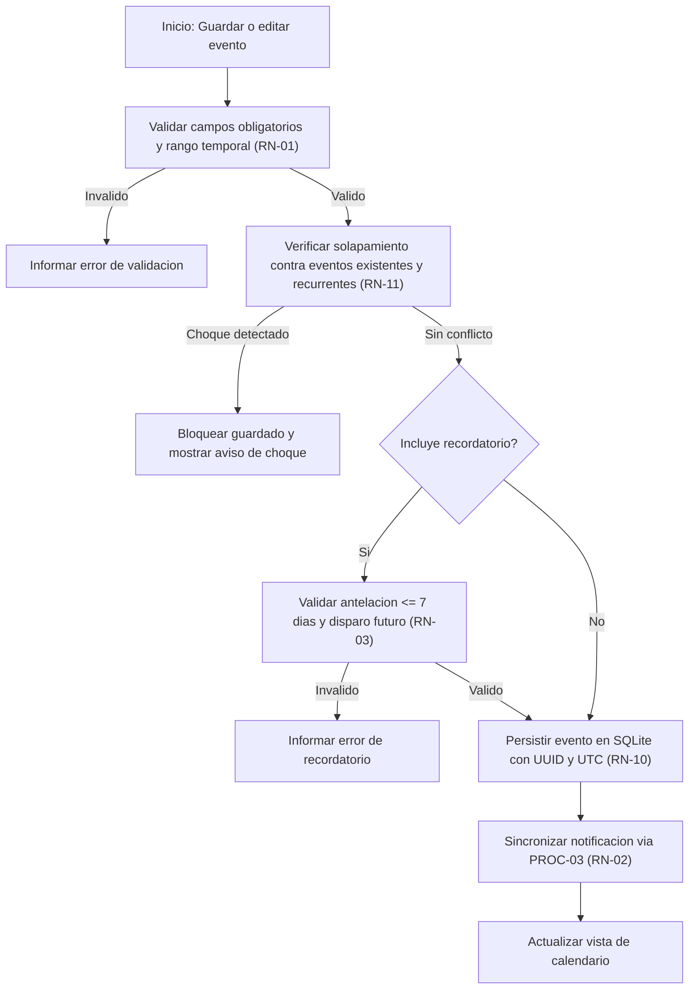
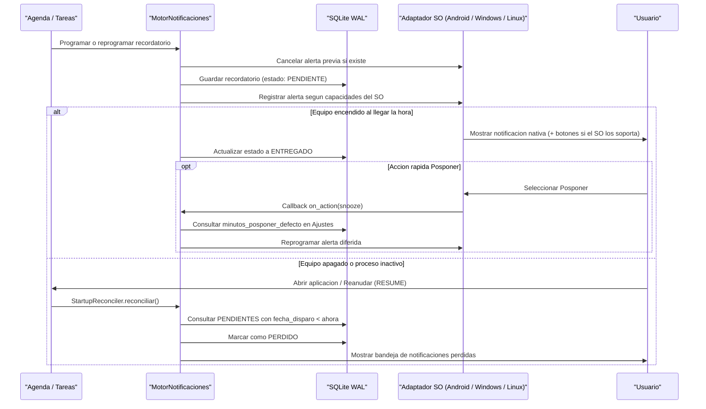
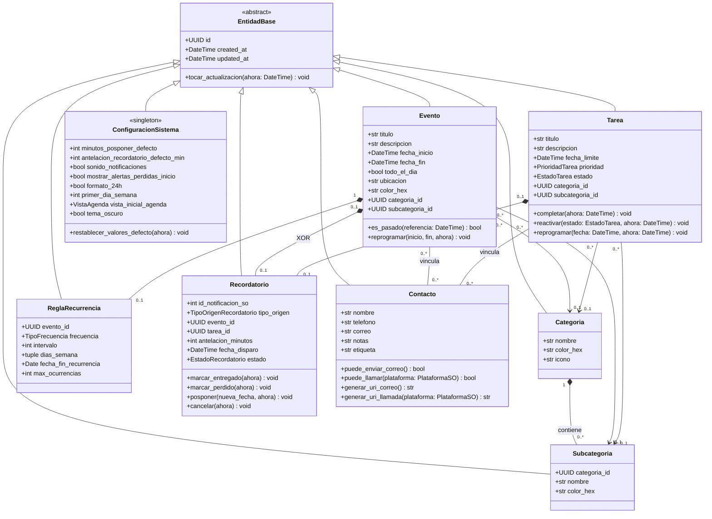
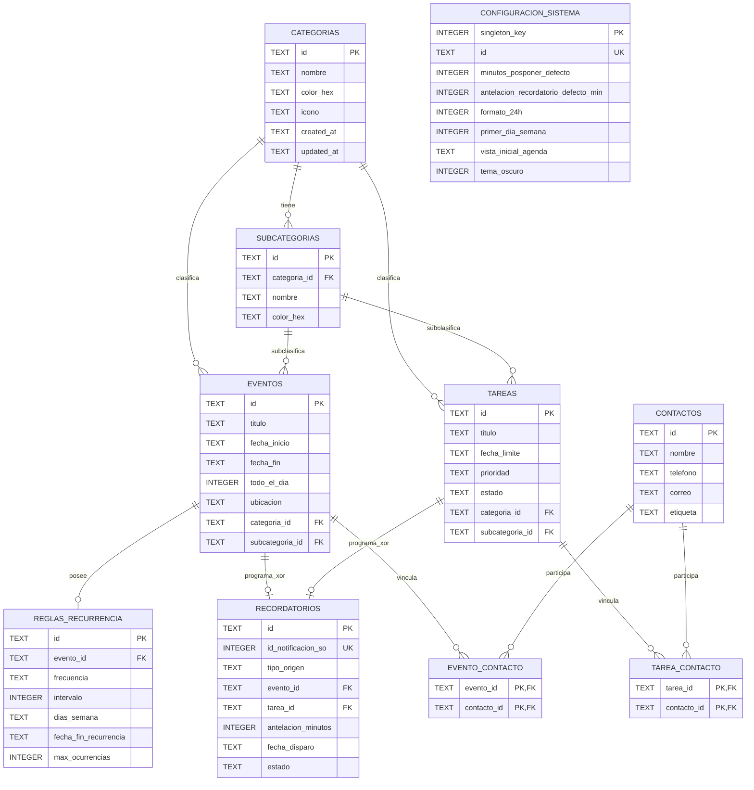
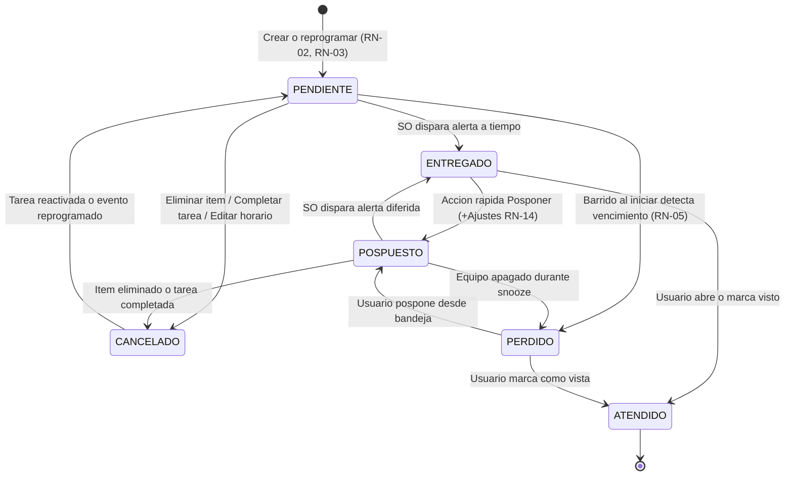
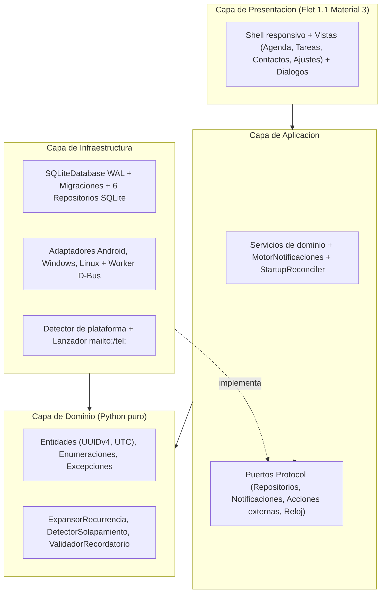

# Documentación Técnica y Reporte de Proyecto

## Agenda Personal y Académica Multiplataforma

---

| Campo | Detalle |
| :--- | :--- |
| **Proyecto** | Agenda Personal y Académica Multiplataforma (`agenda-personal`) |
| **Autor** | Joel Cornelio |
| **Identificador de paquete** | `com.joelcornelio` |
| **Versión documentada** | `1.0.0` |
| **Plataformas objetivo** | Android, Windows y Linux |
| **Tecnologías principales** | Python 3.10+, Flet 1.1, SQLite 3 (WAL), `flet-notifications`, `desktop-notifier`, `uv`, Git |
| **Fecha** | Noviembre de 2026 |

---

## Tabla de Contenidos

1. [Introducción y Planteamiento del Problema](#1-introducción-y-planteamiento-del-problema)
2. [Propuesta del Proyecto](#2-propuesta-del-proyecto)
3. [Ingeniería de Requerimientos](#3-ingeniería-de-requerimientos)
4. [Diseño y Modelado de Datos](#4-diseño-y-modelado-de-datos)
5. [Diseño del Motor Unificado de Notificaciones](#5-diseño-del-motor-unificado-de-notificaciones)
6. [Arquitectura de Software e Implementación](#6-arquitectura-de-software-e-implementación)
7. [Pruebas, Verificación y Evidencia de Ejecución](#7-pruebas-verificación-y-evidencia-de-ejecución)
8. [Conclusiones y Trabajo Futuro](#8-conclusiones-y-trabajo-futuro)

---

## 1. Introducción y Planteamiento del Problema

La organización de actividades personales y académicas suele fragmentarse entre múltiples herramientas independientes: un calendario para clases o citas, una aplicación distinta para listas de pendientes y la libreta del teléfono para los datos de profesores o compañeros. Además, la mayoría de las soluciones comerciales dependen de cuentas en la nube o presentan comportamientos inconsistentes en el manejo de recordatorios entre escritorio y teléfono móvil.

Este proyecto aborda dicho problema mediante el desarrollo de una aplicación propia, multiplataforma y de almacenamiento local (*offline-first*), compuesta por tres módulos funcionales principales —**Agenda**, **Tareas** y **Contactos**—, apoyados por un sistema transversal de **Categorías y Subcategorías**, un panel de **Ajustes** y un **Motor Unificado de Notificaciones**. El núcleo técnico del desarrollo se centra en interactuar con las APIs nativas de notificación de **Android**, **Windows** y **Linux** desde una sola base de código construida en **Python** con **Flet**, manteniendo una arquitectura desacoplada que facilite su mantenimiento y una eventual sincronización entre dispositivos.

---

## 2. Propuesta del Proyecto

### 2.1 Objetivos

#### Objetivo General
Diseñar y desarrollar con Python y Flet una aplicación multiplataforma (Android, Windows y Linux) de agenda personal y académica integrada por los módulos de Agenda, Tareas y Contactos, cuya función principal sea la programación, entrega y recuperación confiable de notificaciones locales mediante las APIs nativas de cada sistema operativo, bajo una arquitectura desacoplada preparada para evolucionar hacia la sincronización multidispositivo.

#### Objetivos Específicos
1. Aplicar la metodología de ingeniería de requerimientos para recolectar necesidades, modelar procesos, especificar requisitos funcionales y no funcionales y formalizar las reglas de negocio del sistema.
2. Diseñar e implementar un motor unificado de notificaciones locales que atienda eventos y tareas sobre Android, Windows y Linux, contemplando antelaciones configurables de hasta una semana, acciones rápidas donde el sistema operativo lo permita y recuperación de alertas perdidas tras apagados.
3. Implementar el módulo de Agenda con gestión de eventos, recurrencias, validación estricta contra solapamientos, historial de eventos pasados y cuatro escalas de visualización (día, semana, mes y año).
4. Implementar el módulo independiente de Tareas con prioridades, estados, fechas límite y sincronización automática de recordatorios al completar o reactivar actividades.
5. Implementar el módulo de Contactos con vinculación a eventos y tareas, desvinculación segura al eliminar registros y delegación a aplicaciones externas según plataforma (`mailto:` y `tel:`).
6. Estructurar el proyecto bajo arquitectura en capas (Puertos y Adaptadores) y principios SOLID, con pruebas automatizadas y control de versiones en Git.

### 2.2 Alcance y Límites

#### Dentro del Alcance (Versión 1.0.0)
* Gestión completa (CRUD) de eventos en Agenda, incluyendo eventos de todo el día, eventos recurrentes, historial y vistas en formato día, semana, mes, año y calendario.
* Validación estricta anti-solapamiento con aviso explícito del evento en conflicto.
* Motor unificado de notificaciones para eventos y tareas (un recordatorio activo por elemento, rango de 0 minutos a 7 días, reprogramación/cancelación automática, avance de recurrencias, detección de notificaciones perdidas y acciones rápidas según capacidades del SO).
* Módulo propio de Tareas separado del calendario.
* Directorio de Contactos vinculable a eventos y tareas, con apertura externa de cliente de correo (`mailto:`) en las tres plataformas y marcador telefónico (`tel:`) exclusivamente en Android.
* Clasificación en dos niveles (categorías principales y subcategorías) con creación rápida en línea.
* Panel de Ajustes persistente para parametrizar tiempo de posponer (*snooze*), antelación por defecto, sonido, alertas perdidas, formato 12h/24h, primer día de la semana, vista inicial y tema claro/oscuro.
* Persistencia local en SQLite 3 (modo WAL) independiente por dispositivo, pero con identificadores globales `UUIDv4` y marcas temporales UTC.

#### Límites (Fuera del Alcance de la Versión 1.0.0)
* No se incluye sincronización en tiempo real entre dispositivos ni servidor remoto en la nube (únicamente se deja preparada la arquitectura).
* No se contemplan plataformas iOS, macOS ni versión web.
* Uso estrictamente individual: no existen cuentas multiusuario ni calendarios compartidos.
* No existe integración bidireccional con calendarios externos (Google Calendar, Outlook o iCloud).
* Se admite un máximo de un recordatorio activo por evento o tarea en esta versión.
* La aplicación delega correo y llamadas a programas externos del sistema operativo; no implementa cliente de correo ni telefonía interna, y deshabilita la acción de llamada en Windows y Linux.

### 2.3 Restricciones

* **Restricción tecnológica obligatoria:** El desarrollo debe realizarse en Python utilizando el framework **Flet** (versión 1.1.x).
* **Restricciones de plataforma en notificaciones:**
  * *Android:* requiere permisos `POST_NOTIFICATIONS` (Android 13+), `RECEIVE_BOOT_COMPLETED` y `SCHEDULE_EXACT_ALARM`, canales de notificación y *broadcast receivers* para sobrevivir a reinicios. Además, en `flet-notifications` el intérprete de Python no se ejecuta en un *isolate* de fondo, lo que condiciona el modo de activación de los botones rápidos.
  * *Windows:* el servicio nativo admite únicamente programación de notificaciones únicas (*one-off*) y cancelación individual por identificador entero, sin soporte para `cancel_all_pending()`.
  * *Linux:* el protocolo FreeDesktop D-Bus (`org.freedesktop.Notifications`) no posee programación diferida nativa; se requiere un planificador local mientras la aplicación está abierta y un proceso ligero residente (`systemd --user`) cuando la ventana está cerrada.
* **Restricciones operativas:** Desarrollo individual en contexto académico y personal, priorizando privacidad local sin telemetría ni dependencia de servicios externos de pago.

### 2.4 Usuarios y Partes Interesadas

| Rol | Perfil | Necesidades |
| :--- | :--- | :--- |
| **Usuario final (Cliente)** | Estudiante y usuario individual con equipo de escritorio (Linux/Windows) y teléfono Android. | Organizar clases, exámenes, compromisos personales, tareas y contactos con alertas confiables y sin dependencia de terceros. |
| **Evaluador académico** | Docente o revisor de la materia. | Verificar la trazabilidad desde la propuesta y los requerimientos hasta el diseño, implementación, pruebas y control de versiones. |

### 2.5 Riesgos Iniciales y Mitigación Aplicada

| ID | Riesgo identificado | Impacto | Mitigación ejecutada |
| :--- | :--- | :--- | :--- |
| R-01 | Fallo o incompatibilidad de notificaciones en segundo plano en Flet entre Android, Windows y Linux. | Crítico | Se diseñó e implementó primero el motor de notificaciones de forma aislada, validando las capacidades reales de `flet-notifications` y D-Bus antes de construir la interfaz. |
| R-02 | Soporte heterogéneo de botones interactivos en entornos de escritorio Linux. | Medio | Consulta en tiempo real de capacidades D-Bus (`Capability.BUTTONS`) con degradación controlada a notificación estándar. |
| R-03 | Construcción manual de cuatro vistas de calendario en Flet al no existir un widget nativo completo. | Medio | Separación de cada escala temporal en componentes independientes y lógica pura de generación de cuadrículas verificada por pruebas unitarias. |
| R-04 | Acoplamiento al almacenamiento local que impida agregar sincronización en el futuro. | Medio | Uso de Puertos y Adaptadores, claves `UUIDv4` y marcas temporales UTC (`created_at`, `updated_at`) en todas las tablas. |

---

## 3. Ingeniería de Requerimientos

### 3.1 Metodología de Recolección de Datos

El levantamiento de requerimientos se llevó a cabo mediante dos técnicas complementarias:

1. **Análisis documental inicial:** revisión de la lista preliminar de necesidades elaborada para el módulo de Agenda (`docs/requerimientos.md`).
2. **Entrevista semiestructurada en dos rondas con el usuario final:**
   * *Ronda 1 (exploración general):* definió la independencia temporal entre dispositivos con bajo acoplamiento a futuro, la restricción obligatoria de usar Flet, los atributos del módulo de Tareas y su separación del calendario, la vinculación de contactos con acciones externas por sistema operativo, la jerarquía de categorías y subcategorías, y el alcance de los recordatorios (1 por ítem, hasta 1 semana antes, detección de perdidas y acciones rápidas).
   * *Ronda 2 (cierre de casos borde):* determinó la prohibición estricta de solapamiento de eventos con aviso de choque, la cancelación automática de recordatorios al completar tareas y su restablecimiento al reprogramar o reactivar, la desvinculación segura sin borrado en cascada y la centralización de parámetros en un módulo de Ajustes.

El registro íntegro de preguntas, respuestas y análisis se conserva en `docs/ing_requerimientos/ingenieria_requerimientos.md` y `docs/ing_requerimientos/especificacion_formal_requerimientos.md`.

### 3.2 Descripción de Procesos del Sistema

Se identificaron y formalizaron seis procesos operativos principales:

| ID | Proceso | Descripción resumida | Reglas asociadas |
| :--- | :--- | :--- | :--- |
| **PROC-01** | Gestión de Eventos | Alta, edición, reprogramación y eliminación de eventos con validación temporal, detección estricta de choques y sincronización de recordatorio. | RN-01, RN-02, RN-03, RN-10, RN-11 |
| **PROC-02** | Consulta de Agenda e Historial | Navegación en vistas de día, semana, mes, año y calendario, filtrado por categoría y consulta de eventos pasados. | RN-04, RN-07, RN-14 |
| **PROC-03** | Motor Unificado de Notificaciones | Programación, reprogramación, cancelación, disparo nativo, acciones rápidas (*Posponer*, *Marcar visto*, *Completar tarea*), avance de recurrencias y barrido de alertas perdidas. | RN-02, RN-03, RN-05, RN-06, RN-12, RN-14 |
| **PROC-04** | Gestión del Ciclo de Vida de Tareas | Administración de tareas en módulo independiente; cancelar recordatorio al completar y restablecerlo al reactivar o modificar fecha límite. | RN-02, RN-03, RN-07, RN-10, RN-12 |
| **PROC-05** | Gestión de Contactos y Acciones Externas | Administración del directorio, búsqueda, vinculación con eventos/tareas, borrado sin cascada y lanzamiento de `mailto:` / `tel:` según sistema operativo. | RN-08, RN-10, RN-13 |
| **PROC-06** | Categorías, Subcategorías y Ajustes | Gestión rápida en dos niveles y parametrización global de comportamiento e interfaz. | RN-09, RN-13, RN-14 |

#### Flujo de Validación y Guardado de Eventos (`PROC-01`)



#### Secuencia de Programación, Acciones Rápidas y Recuperación (`PROC-03`)



### 3.3 Requerimientos Funcionales (RF)

Priorización bajo escala MoSCoW (*Debe*, *Debería*, *Podría*).

| ID | Módulo | Nombre | Descripción | Prioridad | Criterio de verificación |
| :--- | :--- | :--- | :--- | :--- | :--- |
| RF-01 | Agenda | Creación de eventos | Permitir registrar eventos con título y fecha/hora de inicio obligatorios, y fin, descripción, ubicación, clasificación, color, contactos y recordatorio opcionales. | Debe | El evento se almacena con `UUID` y se visualiza en la fecha correspondiente. |
| RF-02 | Agenda | Edición y reprogramación | Permitir modificar atributos y horario de un evento existente. | Debe | Los cambios se persisten y reprograman la notificación asociada. |
| RF-03 | Agenda | Eliminación de eventos | Permitir eliminar eventos previa confirmación. | Debe | El evento se elimina y su notificación pendiente se cancela en el SO. |
| RF-04 | Agenda | Historial de eventos | Permitir consultar eventos futuros y pasados sin purga automática. | Debe | Los eventos vencidos permanecen visibles al navegar o abrir Historial. |
| RF-05 | Agenda | Vistas temporales y calendario | Proveer vistas de día, semana, mes, año y cuadrícula de calendario. | Debe | El cambio de escala muestra las ocurrencias exactas en cada periodo. |
| RF-06 | Agenda | Todo el día y recurrencia | Soportar eventos de todo el día y repetición diaria, semanal (`LU..DO`), mensual y anual. | Debería | Las ocurrencias se expanden automáticamente sin duplicar registros. |
| RF-07 | Agenda | Validación anti-solapamiento | Impedir guardar eventos cuyo horario colisione con otro, mostrando aviso de choque. | Debe | El guardado se bloquea indicando el evento y horario en conflicto. |
| RF-08 | Notificaciones | Motor unificado | Proveer un único motor de notificaciones compartido por Eventos y Tareas. | Debe | Ambos módulos utilizan los mismos servicios y tabla `recordatorios`. |
| RF-09 | Notificaciones | Recordatorio configurable | Admitir 1 recordatorio por ítem, desde la hora exacta hasta 7 días antes, validando disponibilidad. | Debe | Acepta `0..10080` minutos si el disparo es futuro; rechaza valores inválidos. |
| RF-10 | Notificaciones | Adaptadores nativos | Integrar APIs nativas de Android, Windows y Linux mediante adaptadores separados. | Debe | Notificaciones mostradas en el centro nativo del SO en cada plataforma. |
| RF-11 | Notificaciones | Detección de perdidas | Detectar y mostrar alertas no entregadas por apagado o inactividad del equipo. | Debe | Al iniciar tras un vencimiento, la alerta pasa a `PERDIDO` y se muestra al usuario. |
| RF-12 | Notificaciones | Acciones rápidas por SO | Adjuntar botones (*Posponer*, *Marcar visto*, *Completar tarea*) si la API del SO lo soporta. | Debería | Ejecuta callbacks en entornos compatibles y degrada sin error donde no exista soporte. |
| RF-13 | Notificaciones | Sincronía y avance | Cancelar/reprogramar ante cambios y avanzar automáticamente a la siguiente ocurrencia en recurrentes. | Debe | Ninguna alerta obsoleta se dispara y los eventos recurrentes programan su siguiente fecha. |
| RF-14 | Tareas | Módulo independiente | Presentar las tareas en una sección propia separada del calendario. | Debe | Las tareas no se mezclan con los eventos del calendario. |
| RF-15 | Tareas | CRUD de tareas | Crear, consultar, filtrar, editar y eliminar tareas con título, descripción, fecha límite, prioridad, estado, categoría, contactos y recordatorio. | Debe | Persistencia completa y filtros funcionales por estado, prioridad y categoría. |
| RF-16 | Tareas | Ciclo de estado y alertas | Cancelar el recordatorio al completar la tarea y restablecerlo si se reactiva o reprograma. | Debe | Al marcar completada se cancela; al reactivar con fecha vigente se reprograma. |
| RF-17 | Contactos | CRUD y búsqueda | Crear, buscar, filtrar por etiqueta, editar y eliminar contactos (nombre, teléfono, correo, notas, etiqueta). | Debe | Operaciones persistentes y búsqueda en tiempo real operativa. |
| RF-18 | Contactos | Vinculación | Asociar uno o más contactos a eventos y tareas. | Debe | Los contactos asociados se muestran en las tarjetas de eventos y tareas. |
| RF-19 | Contactos | Desvinculación segura | Conservar eventos y tareas intactos al eliminar un contacto vinculado. | Debe | Al eliminar el contacto solo desaparece la asociación en tabla puente. |
| RF-20 | Contactos | Acciones externas por SO | Abrir gestor de correo (`mailto:`) en Android/Windows/Linux y llamadas (`tel:`) solo en Android. | Debe | En Windows y Linux la opción de llamada permanece oculta y bloqueada en dominio. |
| RF-21 | Categorías | Jerarquía de dos niveles | Administrar categorías principales y subcategorías asociadas. | Debe | Se impide crear subcategorías sin categoría padre o de más de dos niveles. |
| RF-22 | Categorías | Creación ágil y borrado seguro | Permitir crear categorías/subcategorías desde formularios y conservar ítems al eliminar una categoría. | Debería | Creación en línea funcional y reasignación a `NULL` sin perder eventos ni tareas. |
| RF-23 | Ajustes | Configuración persistente | Configurar tiempo de posponer, antelación por defecto, sonido, alertas perdidas, formato 12h/24h, primer día de semana, vista inicial y tema claro/oscuro. | Debe | Los cambios se aplican en vivo y persisten al reiniciar la aplicación. |
| RF-24 | Ajustes | Valores por defecto | Inicializar valores seguros en el primer arranque y permitir restablecerlos. | Debería | Una instalación limpia opera sin configuración previa obligatoria. |

### 3.4 Requerimientos No Funcionales (RNF)

| ID | Atributo (ISO/IEC 25010) | Descripción | Criterio de verificación |
| :--- | :--- | :--- | :--- |
| RNF-01 | Restricción tecnológica | Desarrollo en Python >= 3.10 y Flet 1.x empaquetable para Android, Windows y Linux. | Ejecución y compilación con `uv` y `flet-cli`. |
| RNF-02 | Portabilidad | Compatibilidad con Android (API 26+ / Android 13+ permisos), Windows 10/11 y Linux (FreeDesktop D-Bus). | Pruebas de contrato en los tres adaptadores y pruebas nativas en SO destino. |
| RNF-03 | Mantenibilidad | Separación estricta en 4 capas (Puertos y Adaptadores), claves `UUIDv4` y timestamps UTC para futura sincronización. | El dominio no importa `flet` ni `sqlite3`. |
| RNF-04 | Confiabilidad | SQLite como fuente única de verdad y recuperación íntegra de notificaciones perdidas. | El 100% de alertas vencidas sin entregar son marcadas como `PERDIDO`. |
| RNF-05 | Robustez | Degradación elegante ante falta de botones en D-Bus, revocación de alarmas exactas o ausencia de telefonía en escritorio. | Cero excepciones no controladas al variar capacidades del SO. |
| RNF-06 | Disponibilidad | Operación completamente *offline-first* sin dependencia de conexión a internet. | Funcionamiento completo sin red. |
| RNF-07 | Rendimiento | Respuesta fluida en carga de vistas, consultas y validación de solapamientos. | Tiempo de respuesta inferior a 1 segundo en volúmenes locales estándar. |
| RNF-08 | Usabilidad | Interfaz Material 3 adaptable a pantallas móviles (`NavigationBar`) y escritorio (`NavigationRail`), con tema claro/oscuro. | Cambio automático de navegación en el punto de quiebre de 760 px y en Android. |
| RNF-09 | Privacidad | Almacenamiento estrictamente local sin telemetría ni servicios de terceros. | Ausencia de tráfico de red no solicitado por el usuario. |
| RNF-10 | Verificabilidad | Reglas de negocio cubiertas por pruebas automatizadas independientes del entorno gráfico. | Ejecución completa de `pytest` en menos de 2 segundos sin abrir GUI. |

### 3.5 Reglas de Negocio (RN)

| ID | Nombre | Regla formal | Consecuencia / Comportamiento |
| :--- | :--- | :--- | :--- |
| RN-01 | Coherencia temporal | En eventos con horario definido y fecha de fin, debe cumplirse `fecha_fin >= fecha_inicio`. | Se rechaza el guardado con `RangoTemporalInvalidoError`. |
| RN-02 | Sincronía ítem–notificación | Modificar fecha/hora o recordatorio invalida la alerta previa; eliminar el ítem la cancela. | Se cancela el `id_notificacion_so` anterior y se programa el nuevo si corresponde. |
| RN-03 | Límites del recordatorio | Máximo 1 recordatorio activo por evento o tarea; antelación en `[0, 10080]` min (7 días); disparo futuro. | Se rechazan antelaciones fuera de rango o disparos en el pasado. |
| RN-04 | Conservación de historial | Los eventos pasados no se eliminan automáticamente al vencer. | Permanecen almacenados hasta eliminación explícita del usuario. |
| RN-05 | Alertas perdidas | Todo recordatorio `PENDIENTE` o `POSPUESTO` con `fecha_disparo < ahora` al arrancar pasa a `PERDIDO`. | Se muestra al usuario en la bandeja de alertas perdidas para posponer o marcar vista. |
| RN-06 | Degradación de acciones | Las acciones rápidas solo se adjuntan si la API del SO declara soporte. | Si no hay soporte, se emite notificación estándar sin error. |
| RN-07 | Separación Agenda–Tareas | Eventos y tareas viven en módulos separados y no se mezclan visualmente en el calendario. | Comparten motor de notificaciones, categorías y contactos únicamente en capa de datos/servicios. |
| RN-08 | Acciones externas por SO | `mailto:` opera en Android, Windows y Linux; `tel:` opera únicamente en Android. | En escritorio se oculta el botón de llamada y el servicio rechaza la operación. |
| RN-09 | Jerarquía de dos niveles | Toda subcategoría pertenece obligatoriamente a una categoría padre (máximo 2 niveles). | Validado tanto en el dominio como mediante triggers en SQLite. |
| RN-10 | Preparación para sincronización | Todas las entidades persistentes utilizan `UUIDv4` y marcas `created_at`/`updated_at` en UTC. | Evita colisiones de claves primarias al sincronizar dispositivos en versiones futuras. |
| RN-11 | Prohibición de solapamiento | No pueden solaparse dos eventos con franja horaria definida (incluye instancias recurrentes y puntuales sin fin); los eventos de todo el día no bloquean horarios específicos. | Se impide guardar el evento y se despliega un aviso indicando el evento en conflicto. |
| RN-12 | Ciclo de vida en tareas | Completar una tarea cancela su notificación; reactivarla o reprogramar su fecha límite la restablece si sigue vigente. | Garantiza que no suenen recordatorios de tareas ya concluidas. |
| RN-13 | Integridad sin cascada | Eliminar un contacto, subcategoría o categoría nunca borra los eventos ni tareas asociados. | Se eliminan solo los vínculos de tabla puente o se asigna `NULL` en clasificación. |
| RN-14 | Parametrización en Ajustes | Intervalo de posponer, antelación predeterminada, formato horario, primer día de semana y tema se leen desde Ajustes. | Permite personalizar el sistema sin modificar código fuente. |

### 3.6 Matriz de Trazabilidad

| Objetivo específico | Procesos | Requerimientos Funcionales | Requerimientos No Funcionales | Reglas de Negocio |
| :--- | :--- | :--- | :--- | :--- |
| OE-2: Motor de Notificaciones | PROC-03 | RF-08 a RF-13 | RNF-01, RNF-02, RNF-04, RNF-05, RNF-06 | RN-02, RN-03, RN-05, RN-06, RN-12, RN-14 |
| OE-3: Módulo de Agenda | PROC-01, PROC-02 | RF-01 a RF-07 | RNF-06, RNF-07, RNF-08, RNF-10 | RN-01, RN-04, RN-07, RN-11 |
| OE-4: Módulo de Tareas | PROC-04 | RF-14 a RF-16 | RNF-06, RNF-07, RNF-10 | RN-02, RN-03, RN-07, RN-12 |
| OE-5: Módulo de Contactos | PROC-05 | RF-17 a RF-20 | RNF-02, RNF-05, RNF-09 | RN-08, RN-13 |
| OE-6: Organización, Ajustes y Arquitectura | PROC-06 | RF-21 a RF-24 | RNF-01, RNF-03, RNF-08, RNF-09, RNF-10 | RN-09, RN-10, RN-13, RN-14 |

---

## 4. Diseño y Modelado de Datos

### 4.1 Entidades y Relaciones del Dominio

El modelo de dominio se compone de una superclase abstracta (`EntidadBase`), ocho entidades persistentes principales (`Categoria`, `Subcategoria`, `Evento`, `ReglaRecurrencia`, `Tarea`, `Recordatorio`, `Contacto`, `ConfiguracionSistema`), dos tablas asociativas (`evento_contacto`, `tarea_contacto`) y siete enumeraciones de dominio.

Entre las decisiones de diseño más relevantes destacan:
* **Arco exclusivo (XOR) en `Recordatorio`:** cada registro pertenece obligatoriamente a un `Evento` o a una `Tarea`, nunca a ambos, con restricción `UNIQUE` sobre `evento_id` y `tarea_id` para cumplir `RN-03`.
* **Doble identificador en `Recordatorio`:** se mantiene `id` como `UUIDv4` (dominio y futura sincronización) y `id_notificacion_so` como `INTEGER UNIQUE` en rango `1..2,147,483,647` (`int32`), exigido por las APIs nativas de `flet-notifications`.
* **Jerarquía explícita de dos niveles:** separar `Categoria` y `Subcategoria` impide estructuralmente anidamientos arbitrarios (`RN-09`).

### 4.2 Diagrama de Clases UML del Dominio

La versión vectorial completa en formato SVG se encuentra en [`docs/diseno/diagrama_clases.svg`](./diseno/diagrama_clases.svg).



### 4.3 Modelo Entidad–Relación y Esquema SQLite 3

El esquema relacional completo se define en [`docs/diseno/esquema_inicial.sql`](./diseno/esquema_inicial.sql) y su diagrama vectorial en [`docs/diseno/diagrama_entidad_relacion.svg`](./diseno/diagrama_entidad_relacion.svg).



### 4.4 Invariantes de Integridad en Base de Datos

Cada conexión SQLite activa `PRAGMA foreign_keys = ON`, `PRAGMA journal_mode = WAL` (habilitando lectura/escritura concurrente entre la interfaz y el servicio residente en Linux) y `PRAGMA busy_timeout = 5000`.

Adicionalmente, el esquema incorpora cinco triggers:
* Cuatro triggers (`BEFORE INSERT` y `BEFORE UPDATE` sobre `eventos` y `tareas`) que garantizan que cualquier `subcategoria_id` asignada pertenezca realmente al `categoria_id` seleccionado (`RN-09`).
* Un trigger `BEFORE DELETE ON categorias` (`trg_categorias_desvincular_antes_borrar`) que limpia de forma atómica `categoria_id` y `subcategoria_id` antes de ejecutar el `ON DELETE CASCADE` hacia `subcategorias`, evitando conflictos de estados intermedios y garantizando que ningún evento ni tarea se pierda al eliminar una categoría (`RN-13`).

---

## 5. Diseño del Motor Unificado de Notificaciones

### 5.1 Comparativa Real de Capacidades por Plataforma en Flet 1.1

Durante el análisis técnico de la extensión oficial `flet-notifications` (puente sobre `flutter_local_notifications`), se identificaron diferencias determinantes entre los tres sistemas operativos objetivo:

| Capacidad | Android | Windows | Linux |
| :--- | :--- | :--- | :--- |
| Notificación inmediata (`show`) | Soportada (canales Android) | Soportada (*Windows Toast*) | Soportada (FreeDesktop D-Bus) |
| Programación diferida nativa (`schedule`) | Soportada con app cerrada y tras reinicio (`BootReceiver`) | Soportada solo para alertas únicas (*one-off*) | No soportada por `flet-notifications` ni por D-Bus |
| Cancelación de pendientes | Individual y masiva | Solo individual (`cancel(id)`) | Gestionada por planificador local sobre SQLite |
| Acciones rápidas | Soportadas (Python no corre en *isolate* de fondo; *Posponer* usa `foreground=True`) | Soportadas (relanza la app compilada con `flet build`) | Depende de capacidades del servidor D-Bus (KDE Plasma 6.8.3 verificado con soporte `actions`) |

A partir de este análisis se adoptaron tres decisiones de diseño:
1. **SQLite como fuente única de verdad:** las colas nativas solo actúan como mecanismos de disparo; el estado y los metadatos viven siempre en la base local.
2. **Programación *one-off* con avance de recurrencias:** en lugar de depender de recurrencias nativas incompatibles con Windows y Linux, el motor programa la próxima ocurrencia única y `StartupReconciler` avanza automáticamente el recordatorio a la ocurrencia siguiente cuando la anterior se entrega o atiende.
3. **Estrategia híbrida en Linux:** con la aplicación abierta opera un planificador asíncrono `asyncio` que duerme hasta el próximo `fecha_disparo`; con la aplicación cerrada se provee un worker ligero independiente (`linux_worker.py`) ejecutable como servicio de usuario `systemd --user` que lee el mismo archivo SQLite en modo WAL y emite notificaciones D-Bus mediante `desktop-notifier`.

### 5.2 Máquina de Estados del Recordatorio



---

## 6. Arquitectura de Software e Implementación

### 6.1 Arquitectura en Capas (Puertos y Adaptadores) y Principios SOLID

El código fuente se estructuró en cuatro capas con dependencia estricta hacia el dominio central:



Aplicación concreta de principios SOLID:
* **Responsabilidad Única (SRP):** las validaciones de colisión (`DetectorSolapamiento`), expansión de recurrencias (`ExpansorRecurrencia`), reglas de recordatorios (`ValidadorRecordatorio`), reconciliación al inicio (`StartupReconciler`) y formateo local (`formatters.py`) residen en módulos dedicados.
* **Abierto/Cerrado (OCP):** soportar una nueva plataforma solo requiere añadir un adaptador que cumpla `IAdaptadorNotificaciones` y registrarlo en `factory.py`, sin alterar `MotorNotificaciones`.
* **Sustitución de Liskov (LSP):** todos los adaptadores de plataforma y los dobles de prueba respetan el mismo contrato de `IAdaptadorNotificaciones` sin lanzar excepciones no contempladas de plataforma.
* **Segregación de Interfaces (ISP):** los puertos están divididos por agregado (`IRepositorioEventos`, `IRepositorioTareas`, `IRepositorioContactos`, `IRepositorioCategorias`, `IRepositorioRecordatorios`, `IRepositorioAjustes`, `IReloj`, `ILanzadorAccionesExternas`).
* **Inversión de Dependencias (DIP):** la capa de aplicación depende exclusivamente de `typing.Protocol`; las implementaciones concretas se ensamblan en un único *Composition Root* (`src/agenda_app/container.py`).

### 6.2 Estructura del Código Fuente

El proyecto está compuesto por 77 módulos Python organizados bajo `src/agenda_app/`, con migraciones SQL versionadas en `infrastructure/persistence/sqlite/sql/001_initial.sql`:

```text
src/
├── main.py                                  # Punto de entrada mínimo: ft.run(main)
└── agenda_app/
    ├── container.py                         # Inyección de dependencias (ContenedorAplicacion)
    ├── domain/                              # Entidades, enums, excepciones y reglas puras
    ├── application/                         # Puertos (Protocol) y 7 servicios de aplicación
    ├── infrastructure/                      # SQLite WAL, adaptadores de SO, worker Linux
    └── presentation/                        # Tema Material 3, shell responsivo, vistas y diálogos
```

### 6.3 Gestión de Dependencias y Control de Versiones

* **Entorno reproducible:** estandarizado mediante `uv` (`pyproject.toml` y `uv.lock`), separando `desktop-notifier` con marcador de entorno `sys_platform == 'linux'` para evitar dependencias innecesarias en compilaciones de Android y Windows.
* **Flujo de trabajo en Git:** desarrollo incremental con commits atómicos por capa sobre ramas dedicadas integradas a `main` mediante `--no-ff` y liberación etiquetada:
  * `main`: línea base documental (`b82758c`).
  * `feat/motor-notificaciones` $\rightarrow$ integrada en `main` (`3485c1b`).
  * `feat/dominio-y-persistencia` $\rightarrow$ integrada en `main` (`9b2ddfc`).
  * `feat/ui-flet` $\rightarrow$ integrada en `main` (`ee91cfc`), etiquetada como **`v1.0.0`**.

---

## 7. Pruebas, Verificación y Evidencia de Ejecución

### 7.1 Estrategia de Pruebas Multiplataforma desde Linux

Dado que el desarrollo principal se realizó en Linux (KDE Plasma 6.8.3), la verificación de las tres plataformas objetivo se organizó en cuatro niveles complementarios:

1. **Pruebas unitarias de dominio y motor (`tests/unit/`):** utilizan `FakeClock` (simulación determinista de tiempo) y repositorios/adaptadores en memoria para validar límites de 7 días, rechazo de disparos pasados, arco XOR, rangos `int32`, expansión semanal/mensual, solapamiento estricto (incluyendo puntuales, todo el día y recurrentes), cancelación/reactivación de tareas, *snooze* desde Ajustes y detección de alertas perdidas.
2. **Pruebas de contrato de adaptadores (`tests/unit/test_adaptadores_contrato.py`):** validan el comportamiento real de `AdaptadorNotificacionesAndroid` (degradación a modo inexacto y `foreground=True` en *Posponer*), `AdaptadorNotificacionesWindows` (*one-off* y cancelación individual) y `AdaptadorNotificacionesLinux` (planificador `asyncio` sin llamar `schedule()` y degradación D-Bus) inyectando un doble estricto de `flet_notifications.Notifications`.
3. **Pruebas de integración sobre SQLite real en disco (`tests/integration/`):** verifican la aplicación idempotente de `001_initial.sql`, el modo `WAL` con acceso concurrente simulando aplicación + worker Linux, triggers de jerarquía de categorías, integridad referencial sin borrado en cascada al eliminar contactos/categorías, avance de recurrencias y el flujo completo de acciones rápidas de notificación actualizando SQLite.
4. **Pruebas de capa de presentación (`tests/unit/test_formatters.py`, `tests/unit/test_ui_views.py` y `tests/test_main.py`):** verifican cuadrículas de calendario, navegación entre los 4 módulos, apertura de formularios, cambio responsivo `NavigationRail`/`NavigationBar` y cambio en vivo de tema claro/oscuro.

### 7.2 Resultados de la Suite Automatizada

Comando ejecutado: `uv run pytest tests/unit tests/integration -v`

| Archivo de pruebas | Casos cubiertos | Estado |
| :--- | :--- | :--- |
| `tests/unit/test_recordatorio_rules.py` | 5 pruebas (límites 7 días, pasado, XOR, `int32`, payload JSON) | Superado |
| `tests/unit/test_motor_notificaciones.py` | 3 pruebas (reprogramación, *snooze* Ajustes, degradación, `StartupReconciler`) | Superado |
| `tests/unit/test_adaptadores_contrato.py` | 3 pruebas (contratos Android, Windows y Linux `asyncio`) | Superado |
| `tests/unit/test_recurrencia_y_solapamiento.py` | 4 pruebas (coherencia temporal, recurrencia semanal/mensual, solapamiento) | Superado |
| `tests/unit/test_servicios_dominio.py` | 3 pruebas (eventos, tareas completar/reactivar, contactos por SO y categorías) | Superado |
| `tests/unit/test_formatters.py` | 3 pruebas (cuadrícula mensual/semanal, antelación, todo el día) | Superado |
| `tests/unit/test_ui_views.py` | 1 prueba integral de navegación, 4 vistas, formularios, responsividad y tema | Superado |
| `tests/integration/test_sqlite_recordatorios.py` | 1 prueba integral SQLite WAL concurrente y reconciliación | Superado |
| `tests/integration/test_persistencia_completa.py` | 2 pruebas integrales (integridad sin cascada, callback notificación y avance recurrentes) | Superado |
| **Total** | **25 pruebas automatizadas — 0 advertencias (0.86 s)** | **100% Superado** |

### 7.3 Evidencia de Ejecución en Desarrollo y Multiplataforma

Los siguientes espacios están reservados para incorporar las capturas de pantalla definitivas obtenidas en el entorno de desarrollo y en las compilaciones por plataforma.

#### Entorno de Desarrollo y Pruebas

> **Figura 1.** *Captura de ejecución en entorno de desarrollo: terminal ejecutando la suite de pruebas (`uv run pytest`) con los 25 casos superados y estructura del proyecto en el editor.*  
> *(Insertar captura aquí)*

#### Ejecución en Linux (KDE Plasma)

> **Figura 2.** *Captura de ejecución en Linux (escritorio): Módulo de Agenda mostrando el `NavigationRail` lateral, la vista mensual tipo calendario y el detalle de eventos del día.*  
> *(Insertar captura aquí)*

> **Figura 3.** *Captura de ejecución en Linux: Vistas temporales alternativas de la Agenda (Día, Semana y Año) y ventana de Historial de eventos pasados.*  
> *(Insertar captura aquí)*

> **Figura 4.** *Captura de ejecución en Linux: Formulario de creación/edición de evento desplegando el aviso de choque de horarios ante intento de solapamiento.*  
> *(Insertar captura aquí)*

> **Figura 5.** *Captura de ejecución en Linux (KDE Plasma): Notificación nativa entregada vía D-Bus con botones de acción rápida ("Posponer" y "Marcar como visto") y diálogo de bandeja de notificaciones perdidas.*  
> *(Insertar captura aquí)*

> **Figura 6.** *Captura de ejecución en Linux: Módulo independiente de Tareas (filtros, prioridades y estados) y Módulo de Contactos mostrando la acción de correo habilitada y la omisión de llamadas en escritorio.*  
> *(Insertar captura aquí)*

> **Figura 7.** *Captura de ejecución en Linux: Módulo de Ajustes en modo claro y modo oscuro, diagnóstico de plataforma y gestor de Categorías y Subcategorías.*  
> *(Insertar captura aquí)*

#### Ejecución en Android

> **Figura 8.** *Captura de ejecución en Android: Interfaz móvil con barra de navegación inferior (`NavigationBar`), vista de Agenda y detalle de Contacto con botón de llamada (`tel:`) habilitado.*  
> *(Insertar captura aquí)*

> **Figura 9.** *Captura de ejecución en Android: Notificación programada entregada con la aplicación cerrada mostrando los botones de acción rápida y permisos de alarmas exactas.*  
> *(Insertar captura aquí)*

#### Ejecución en Windows

> **Figura 10.** *Captura de ejecución en Windows: Interfaz de escritorio empaquetada y entrega de notificación nativa (Windows Toast).*  
> *(Insertar captura aquí)*

---

## 8. Conclusiones y Trabajo Futuro

El desarrollo de la versión `1.0.0` de la Agenda Personal y Académica demuestra que es factible construir una aplicación multiplataforma en Python y Flet con soporte real para notificaciones locales sobre Android, Windows y Linux, siempre que las particularidades de cada sistema operativo se aíslen detrás de puertos claros y se adopte la base de datos local como fuente única de verdad.

La separación en cuatro capas permitió validar todas las reglas de negocio —incluyendo detección estricta de choques de horario, recurrencias, integridad referencial sin borrado en cascada, recuperación de notificaciones perdidas y contratos de los tres adaptadores de SO— antes de construir la interfaz gráfica, reduciendo retrabajos y logrando una suite de 25 pruebas ejecutables en menos de un segundo.

Como líneas concretas de evolución posterior a esta entrega se contemplan:
1. **Integración continua y compilación en la nube (GitHub Actions):** automatizar la ejecución de `pytest` en cada envío de cambios y la generación de artefactos compilados para Linux, Windows y Android por etiqueta de versión.
2. **Versión 1.1 (respaldos y subtareas):** incorporación de exportación/importación manual de copias de seguridad de `agenda_personal.db` desde Ajustes y listas de verificación (*checklist*) dentro de cada tarea.
3. **Versión 2.0 (sincronización multidispositivo):** implementación de un adaptador de sincronización en `infrastructure/sync/` aprovechando la estructura ya existente de claves `UUIDv4` y marcas temporales UTC sin modificar la capa de dominio ni la interfaz.
