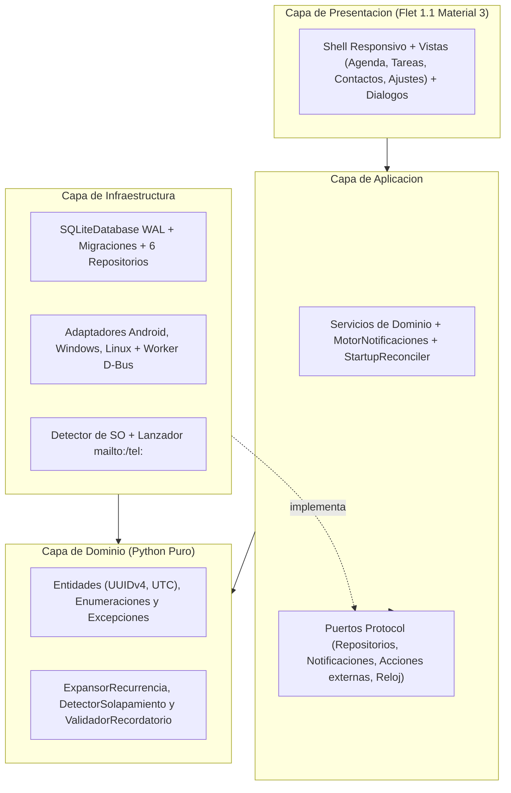
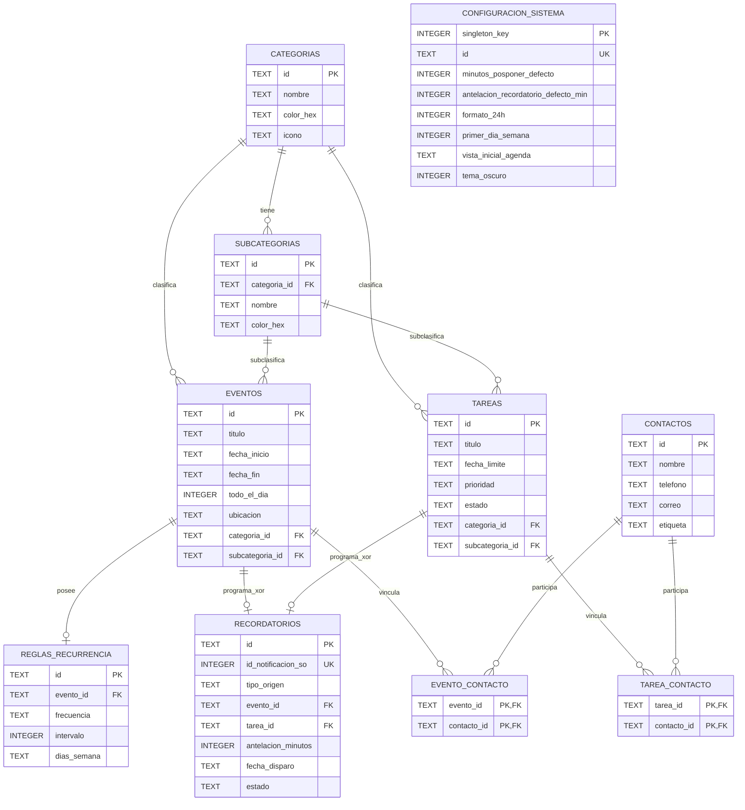

# Documentación: Proyecto Flet

## Atempo — Aplicación Multiplataforma de Agenda Personal y Académica

**Institución:** Universidad Juárez Autónoma de Tabasco  
**División:** División Académica de Ciencias y Tecnologías de la Información (DACYTI)  
**Asignatura:** Desarrollo de Aplicaciones Multiplataforma  
**Alumno:** Joel Cornelio  
**Matrícula:** `[Ingresar matrícula]`  
**Fecha:** 24 de noviembre de 2026  

---

## 1. Introducción

El desarrollo de aplicaciones multiplataforma representa actualmente uno de los retos más relevantes dentro de la ingeniería de software, pues exige diseñar sistemas capaces de operar con una sola base de código en ecosistemas distintos —tanto de escritorio como móviles— sin sacrificar estabilidad, experiencia de usuario ni integración con las capacidades nativas de cada sistema operativo. En el marco de la asignatura **Desarrollo de Aplicaciones Multiplataforma**, el verdadero desafío no consiste únicamente en dibujar una interfaz que se adapte a distintos tamaños de pantalla, sino en resolver las diferencias estructurales entre plataformas como **Android**, **Windows** y **Linux**: permisos en tiempo de ejecución, ejecución en segundo plano, políticas de ahorro de energía, protocolos de notificación del sistema y disponibilidad de funciones propias del dispositivo como la telefonía.

De forma paralela, en el ámbito personal y académico resulta frecuente dispersar clases, entregas, recordatorios y datos de contacto en herramientas separadas que dependen de cuentas en la nube o presentan comportamientos irregulares al sincronizar alertas entre la computadora y el teléfono. Frente a esta necesidad, el presente proyecto documenta el diseño, implementación y empaquetado de **Atempo**, una aplicación multiplataforma de gestión personal y académica desarrollada en **Python** con **Flet** (sobre el motor gráfico de Flutter) y almacenamiento local en **SQLite 3**.

La aplicación integra en un solo entorno los módulos de **Agenda**, **Tareas**, **Contactos**, **Categorías/Subcategorías** y **Ajustes**, articulados alrededor de un **Motor Unificado de Notificaciones** que interactúa con las APIs nativas de Android, Windows y Linux. Su arquitectura desacoplada permite mantener la lógica de negocio y la persistencia completamente aisladas de la interfaz y de los adaptadores de plataforma, demostrando de manera práctica los principios, patrones y herramientas abordados a lo largo de la asignatura.

---

## 2. Objetivos

### 2.1 Objetivo General
Desarrollar, probar y empaquetar una aplicación multiplataforma (Android, Windows y Linux) de agenda personal y académica con Python y Flet que integre la gestión de eventos, tareas y contactos con un sistema confiable de notificaciones locales nativas y almacenamiento autónomo en SQLite.

### 2.2 Objetivos Específicos
1. Aplicar los fundamentos de la asignatura Desarrollo de Aplicaciones Multiplataforma mediante una arquitectura desacoplada en capas (Puertos y Adaptadores y principios SOLID) que aísle la lógica de negocio de la interfaz gráfica y de las APIs particulares de Android, Windows y Linux.
2. Implementar un motor unificado de notificaciones locales capaz de atender eventos y tareas con rangos de antelación configurables de hasta 7 días, detección de alertas perdidas tras apagados, avance automático de recurrencias y degradación controlada de acciones rápidas según el sistema operativo.
3. Implementar la persistencia local en **SQLite 3** (modo WAL y claves foráneas estrictas) empleando identificadores `UUIDv4` y marcas temporales en UTC para garantizar autonomía sin conexión y facilitar una futura sincronización entre dispositivos.
4. Diseñar una interfaz gráfica responsiva basada en Material Design 3 con navegación adaptable (`NavigationRail` en escritorio y `NavigationBar` en Android), cuatro vistas de calendario (día, semana, mes y año) y conmutación en vivo entre modo claro y modo oscuro.
5. Automatizar la ejecución de pruebas unitarias e integración y la compilación de binarios nativos para Android (`.apk`), Linux y Windows mediante flujos de trabajo en GitHub Actions.

---

## 3. Requerimientos

### 3.1 Requerimientos Funcionales

1. **Gestión completa de eventos (Módulo de Agenda):** Permitir crear, consultar, modificar, reprogramar y eliminar eventos especificando título y fecha/hora de inicio obligatorios, así como fecha/hora de fin, indicador de todo el día, descripción, ubicación, clasificación, contactos vinculados y recordatorio.
2. **Eventos recurrentes e historial:** Soportar repetición diaria, semanal (por días específicos `LU` a `DO`), mensual y anual sin duplicar registros manuales, conservando los eventos vencidos en un historial consultable.
3. **Vistas temporales de calendario:** Disponer de vistas en formato de **Día**, **Semana**, **Mes** (estilo calendario interactivo con panel del día seleccionado) y **Año** (mapa de densidad mensual), además de filtros por categoría.
4. **Validación estricta anti-solapamiento:** Impedir el guardado o edición de eventos cuyo rango horario colisione con otro evento existente (incluyendo ocurrencias de eventos recurrentes), mostrando un aviso claro con el evento en conflicto. Los eventos de todo el día no bloquean compromisos con horario específico.
5. **Motor unificado de notificaciones (Agenda y Tareas):** Permitir configurar un recordatorio por evento o tarea desde la hora exacta hasta 7 días antes, validando que el disparo sea futuro. Ante modificaciones o eliminaciones, cancelar y reprogramar automáticamente en el sistema operativo.
6. **Acciones rápidas y recuperación de alertas perdidas:** Adjuntar botones de acción rápida (*Posponer*, *Marcar como visto* y *Completar tarea*) en los sistemas que lo soporten, y detectar al iniciar o reanudar la aplicación cualquier alerta vencida mientras el equipo estuvo apagado, presentándola en una bandeja dedicada.
7. **Gestión de pendientes en módulo independiente (Módulo de Tareas):** Administrar tareas en una sección separada del calendario con título, descripción, fecha límite opcional, prioridad (*Alta, Media, Baja*), estado (*Pendiente, En progreso, Completada*), filtros y sincronización automática del recordatorio al completar o reactivar la tarea.
8. **Directorio de contactos y acciones externas por plataforma (Módulo de Contactos):** Registrar, buscar, filtrar por etiqueta y vincular contactos a eventos y tareas, con apertura externa del gestor de correo (`mailto:`) en las tres plataformas y del marcador telefónico (`tel:`) exclusivamente en Android.
9. **Clasificación en dos niveles (Categorías y Subcategorías):** Crear, gestionar y asignar categorías principales (por ejemplo, *Universidad*, *Personal*, *Trabajo*) y subcategorías (materias o áreas) de forma rápida incluso desde los formularios de eventos y tareas.
10. **Configuración centralizada (Módulo de Ajustes):** Permitir modificar en vivo y persistir el intervalo de posponer (*snooze*), antelación predeterminada, sonido, aviso de alertas perdidas al iniciar, formato horario 12h/24h, primer día de la semana, vista inicial de agenda, tema claro/oscuro y diagnóstico de permisos del sistema operativo.

### 3.2 Requerimientos No Funcionales

1. **Portabilidad multiplataforma:** La aplicación opera nativamente en escritorio (**Linux** y **Windows**) y dispositivos móviles (**Android**) desde una sola base de código en Python y Flet, con compilación nativa mediante `flet build` y adaptación automática de capacidades por sistema operativo.
2. **Persistencia local y autonomía:** Toda la información reside localmente en el archivo `agenda_personal.db` bajo SQLite 3 con `PRAGMA foreign_keys = ON` y modo `WAL`, operando al 100% sin conexión a internet y sin envío de telemetría.
3. **Modularidad y mantenibilidad:** Código organizado en cuatro capas desacopladas (`domain`, `application`, `infrastructure`, `presentation`) con inversión de dependencias mediante `Protocol`, claves `UUIDv4` y marcas UTC preparadas para una futura capa de sincronización.
4. **Confiabilidad y degradación elegante:** SQLite actúa como fuente única de verdad frente a reinicios o revocación de permisos; si un entorno de escritorio Linux no soporta botones D-Bus o si Android revoca alarmas exactas, el sistema degrada sin fallos críticos.
5. **Verificabilidad automatizada:** Las reglas de negocio críticas, los contratos de los adaptadores de Android, Windows y Linux y la integridad de SQLite se verifican mediante una suite automatizada con `pytest` ejecutable sin entorno gráfico.

### 3.3 Reglas de Negocio Principales

1. **Coherencia temporal:** En todo evento con rango horario definido debe cumplirse `fecha_fin >= fecha_inicio`.
2. **Límite de recordatorio:** Cada evento o tarea admite máximo un recordatorio activo con antelación de `0` a `10,080` minutos (7 días) y fecha de disparo futura.
3. **Ciclo de vida en tareas:** Marcar una tarea como completada cancela su notificación pendiente; reactivarla o reprogramar su fecha límite restablece el recordatorio si sigue vigente.
4. **Integridad sin borrado en cascada:** Eliminar un contacto, subcategoría o categoría nunca borra los eventos ni tareas asociados; únicamente desvincula las referencias o reasigna la clasificación a `NULL`.
5. **Discriminación por plataforma en contactos:** La acción `tel:` se habilita únicamente en Android y se oculta y bloquea en Linux y Windows.

---

## 4. Herramientas Tecnológicas Utilizadas

El proyecto hace uso de herramientas modernas orientadas a portabilidad, reproducibilidad del entorno y compilación multiplataforma.

| Componente | Tecnología | Función en el proyecto |
| :--- | :--- | :--- |
| **Lenguaje principal** | Python 3.14 (`>= 3.10`) | Lógica de dominio, servicios de aplicación, tipado estático y orquestación asíncrona. |
| **Framework de UI** | Flet 1.1.3 (Flutter) | Construcción de interfaces reactivas Material Design 3 para Android, Linux y Windows desde una sola base de código. |
| **Notificaciones nativas** | `flet-notifications 1.1.3` y `desktop-notifier 6.2.0` | Programación y entrega nativa en Android (`AlarmManager`) y Windows (*Toast*); planificador `asyncio` y worker residente D-Bus en Linux. |
| **Gestor de base de datos** | SQLite 3 (modo WAL) | Persistencia local autónoma con claves `UUIDv4`, integridad referencial estricta, índices y triggers de validación. |
| **Gestor de dependencias** | `uv` (`pyproject.toml` / `uv.lock`) | Administración reproducible de entornos virtuales y bloqueo exacto de versiones de paquetes. |
| **Empaquetado y CI/CD** | `flet-cli` (`flet build`) y GitHub Actions (`flet-dev/flet-build-action@v1`) | Ejecución continua de pruebas y compilación en la nube de ejecutables para Linux, Windows y APK para Android. |
| **Pruebas automatizadas** | `pytest 9.2` y `pytest-asyncio 1.5` | Verificación unitaria de reglas de negocio, pruebas de contrato multiplataforma e integración real con SQLite. |
| **Control de versiones** | Git y GitHub | Versionado mediante ramas dedicadas por módulo, commits semánticos, integraciones `--no-ff` y publicación de Releases. |

---

## 5. Arquitectura del Sistema y Modelo de Datos

El código está estructurado siguiendo la arquitectura de **Puertos y Adaptadores (Arquitectura Limpia)** y los principios **SOLID**, garantizando que la capa de dominio no dependa de Flet ni de SQLite y que cada sistema operativo se aísle en su propio adaptador.

### 5.1 Organización de Carpetas y Módulos

| Archivo / Directorio | Función principal |
| :--- | :--- |
| `src/main.py` | Punto de entrada mínimo que inicia la aplicación Flet (`ft.run`). |
| `src/agenda_app/container.py` | *Composition Root* que ensambla repositorios, adaptadores según el SO detectado, motor de notificaciones y servicios. |
| `src/agenda_app/domain/` | Entidades (`Evento`, `ReglaRecurrencia`, `Tarea`, `Recordatorio`, `Contacto`, `Categoria`, `Subcategoria`, `ConfiguracionSistema`), enumeraciones, excepciones y reglas puras (`ExpansorRecurrencia`, `DetectorSolapamiento`, `ValidadorRecordatorio`). |
| `src/agenda_app/application/ports/` | Interfaces `Protocol` segregadas para repositorios, reloj, lanzador de URIs externos y adaptador de notificaciones. |
| `src/agenda_app/application/services/` | Casos de uso (`ServicioEventos`, `ServicioTareas`, `ServicioContactos`, `ServicioCategorias`, `ServicioAjustes`, `MotorNotificaciones` y `StartupReconciler`). |
| `src/agenda_app/infrastructure/persistence/sqlite/` | Conexión SQLite en modo WAL, migraciones versionadas (`001_initial.sql`) y los seis repositorios concretos. |
| `src/agenda_app/infrastructure/notifications/` | Adaptadores nativos para Android, Windows y Linux, fábrica por plataforma y servicio residente `linux_worker.py` para `systemd --user`. |
| `src/agenda_app/infrastructure/platform/` | Detector de plataforma y lanzador externo condicionado por SO (`mailto:` multiplataforma y `tel:` exclusivo de Android). |
| `src/agenda_app/presentation/` | Tema Material 3 (claro/oscuro), formateadores `UTC <-> Local`, shell responsivo (`NavigationBar`/`NavigationRail`), vistas de Agenda (Día, Semana, Mes, Año), Tareas, Contactos, Ajustes y diálogos modales. |
| `src/assets/icon.svg` | Ícono vectorial minimalista personalizado de **Atempo** usado por `flet build` para generar los íconos de cada plataforma. |
| `.github/workflows/` | Pipelines de GitHub Actions (`ci.yml` para pruebas en Linux/Windows y `build.yml` para compilación y Releases). |
| `tests/` | Suite automatizada dividida en pruebas unitarias (`tests/unit/`), integración SQLite (`tests/integration/`) y prueba de arranque Flet (`tests/test_main.py`). |

### 5.2 Diagrama de Arquitectura y Capas

### 5.3 Diagrama de Clases y Modelo Relacional de Datos

Los diagramas vectoriales completos de diseño se encuentran disponibles en [`docs/diseno/diagrama_clases.svg`](./diseno/diagrama_clases.svg), [`docs/diseno/diagrama_entidad_relacion.svg`](./diseno/diagrama_entidad_relacion.svg) y el script DDL verificado en [`docs/diseno/esquema_inicial.sql`](./diseno/esquema_inicial.sql).

### 5.4 Estrategia del Motor de Notificaciones por Sistema Operativo

Dado que `flet-notifications` presenta capacidades distintas en cada plataforma, el motor mantiene la tabla `recordatorios` como fuente única de verdad y aplica una estrategia específica detrás de `IAdaptadorNotificaciones`:

* **Android:** emplea `schedule()` con `EXACT_ALLOW_WHILE_IDLE` (degradando automáticamente a `INEXACT_ALLOW_WHILE_IDLE` si el permiso exacto no está concedido), declara `ScheduledNotificationBootReceiver` en `pyproject.toml` para sobrevivir reinicios y configura el botón *Posponer* con `foreground=True` para que el intérprete Python reprograme la nueva alerta.
* **Windows:** programa notificaciones únicas (*one-off*) y realiza cancelaciones individuales por `id_notificacion_so` (`int32`), ya que la API de Windows no admite cancelación masiva de pendientes ni recurrencias nativas.
* **Linux:** al no existir programación diferida en FreeDesktop D-Bus, utiliza un planificador asíncrono `asyncio` mientras la aplicación está abierta y ofrece un proceso ligero opcional (`linux_worker.py`) registrable en `systemd --user` que lee el mismo archivo SQLite en modo WAL y emite notificaciones con botones vía `desktop-notifier`.

---

## 6. Evidencias de Desarrollo y Compilación

En esta sección se documentan las evidencias del entorno de desarrollo, la gestión del repositorio, la ejecución de pruebas y los procesos de compilación local y automatizada en la nube.

### 6.1 Entorno de Desarrollo, Dependencias y Control de Versiones

> **Captura 1 — Entorno de desarrollo y estructura del proyecto:** *Vista del editor (VS Code) mostrando la estructura en capas de `src/agenda_app/` (`domain`, `application`, `infrastructure`, `presentation`) y el archivo `pyproject.toml` con las dependencias y permisos Android.*  
> *(Insertar captura aquí)*

> **Captura 2 — Gestión de entorno reproducible con `uv`:** *Terminal ejecutando `uv sync` y verificando la creación del entorno virtual `.venv` y la resolución de dependencias (`flet`, `flet-notifications`, `desktop-notifier`, `pytest`).*  
> *(Insertar captura aquí)*

> **Captura 3 — Control de versiones en Git y GitHub:** *Terminal mostrando el historial de ramas y merges (`git log --graph --oneline`) junto con la vista del repositorio remoto en GitHub (`JoelCOsorio/Agenda-Personal`).*  
> *(Insertar captura aquí)*

### 6.2 Compilación Local y Automatizada en la Nube (GitHub Actions)

> **Captura 4 — Compilación local en Linux:** *Terminal ejecutando el empaquetado local con `uv run flet build linux -v` (o preparación de dependencias del sistema) y mostrando el binario generado en `build/linux/`.*  
> *(Insertar captura aquí)*

> **Captura 5 — Integración Continua (`ci.yml`) en GitHub Actions:** *Vista de GitHub Actions mostrando la ejecución exitosa del workflow `CI - Pruebas Automatizadas` en paralelo sobre `ubuntu-latest` y `windows-latest`.*  
> *(Insertar captura aquí)*

> **Captura 6 — Compilación multiplataforma en la nube (`build.yml`):** *Resumen del workflow `Build Multiplataforma (Android, Linux, Windows)` en GitHub Actions mostrando en verde la verificación de pruebas y la compilación simultánea de `apk`, `linux` y `windows` con sus artefactos generados.*  
> *(Insertar captura aquí)*

> **Captura 7 — Publicación de Release en GitHub:** *Sección de Releases del repositorio mostrando la etiqueta de versión (`v1.0.0`) con los paquetes compilados adjuntos listos para descargar.*  
> *(Insertar captura aquí)*

---

## 7. Pruebas y Demostración de Funcionalidades

### 7.1 Suite de Pruebas Automatizadas

Para asegurar el cumplimiento de las reglas de negocio antes de empaquetar, se construyó una suite de **25 pruebas automatizadas** que cubren dominio puro, motor de notificaciones, contratos de los adaptadores de Android/Windows/Linux, integración real con SQLite WAL y navegación de vistas UI. Todas se ejecutan con `uv run pytest tests/unit tests/integration -v` (25 pruebas superadas en 0.86 s, 0 advertencias).

> **Captura 8 — Ejecución de pruebas automatizadas:** *Terminal mostrando la salida completa de `uv run pytest tests/unit tests/integration -v` con los 25 casos superados.*  
> *(Insertar captura aquí)*

### 7.2 Ejecución y Demostración de Funcionalidades en Linux (KDE Plasma)

> **Captura 9 — Arranque del ejecutable en Linux y vista mensual de Agenda:** *Terminal lanzando el binario compilado junto a la ventana de Atempo mostrando el `NavigationRail` lateral, la cuadrícula mensual del calendario y el panel de eventos del día.*  
> *(Insertar captura aquí)*

> **Captura 10 — Vistas Día, Semana, Año e Historial:** *Demostración de la conmutación entre las escalas temporales de la agenda (Día, Semana y Año) y el diálogo de Historial de eventos pasados.*  
> *(Insertar captura aquí)*

> **Captura 11 — Creación de evento, recurrencia y categoría rápida en línea:** *Formulario modal de evento configurando repetición semanal, recordatorio y creación rápida de una categoría/subcategoría sin salir del formulario.*  
> *(Insertar captura aquí)*

> **Captura 12 — Validación anti-solapamiento (choque de horarios):** *Formulario de evento mostrando el aviso rojo de choque de horarios al intentar registrar una actividad superpuesta con otra existente.*  
> *(Insertar captura aquí)*

> **Captura 13 — Notificación nativa en KDE Plasma y bandeja de perdidas:** *Notificación emergente nativa en el escritorio Linux con los botones "Posponer" y "Marcar como visto", junto con el diálogo de bandeja de notificaciones perdidas tras simular inactividad.*  
> *(Insertar captura aquí)*

> **Captura 14 — Servicio en segundo plano en Linux (`systemd --user`):** *Terminal mostrando el estado activo de `agenda-notificaciones.service` (`linux_worker.py`) entregando una alerta mientras la ventana principal está cerrada.*  
> *(Insertar captura aquí)*

> **Captura 15 — Módulo independiente de Tareas:** *Vista de Tareas mostrando filtros por estado, prioridad y categoría, tarjetas con insignia de prioridad y recordatorio, y marcado de una tarea como completada.*  
> *(Insertar captura aquí)*

> **Captura 16 — Módulo de Contactos en escritorio:** *Directorio de contactos con búsqueda en tiempo real, etiquetas, botón de correo (`mailto:`) habilitado y verificación de que el botón de llamada no se muestra en Linux.*  
> *(Insertar captura aquí)*

> **Captura 17 — Módulo de Ajustes (Modo Claro vs. Modo Oscuro) y gestor de categorías:** *Comparativa visual del cambio en vivo a modo oscuro, configuración de tiempo de posponer, diagnóstico de plataforma y gestor de categorías/subcategorías.*  
> *(Insertar captura aquí)*

### 7.3 Ejecución y Demostración en Android

> **Captura 18 — Instalación y lanzador en Android:** *Ícono minimalista de Atempo instalado en el dispositivo Android a partir del APK generado en GitHub Actions.*  
> *(Insertar captura aquí)*

> **Captura 19 — Interfaz móvil responsiva (`NavigationBar`):** *Vistas de Agenda y Tareas en pantalla vertical Android mostrando la barra de navegación inferior y el botón flotante contextual.*  
> *(Insertar captura aquí)*

> **Captura 20 — Contactos con llamada nativa en Android:** *Tarjeta de contacto en Android mostrando tanto el botón de correo (`mailto:`) como el botón de llamada (`tel:`) abriendo el marcador telefónico.*  
> *(Insertar captura aquí)*

> **Captura 21 — Notificación nativa y permisos en Android:** *Pantalla de permisos de notificaciones/alarmas exactas en Android y notificación programada entregada con la aplicación cerrada mostrando acciones rápidas.*  
> *(Insertar captura aquí)*

### 7.4 Ejecución y Demostración en Windows

> **Captura 22 — Ejecución del paquete compilado en Windows:** *Ventana de escritorio de Atempo ejecutándose en Windows 10/11 mostrando la interfaz responsiva y la persistencia local.*  
> *(Insertar captura aquí)*

> **Captura 23 — Notificación nativa en Windows (*Windows Toast*):** *Alerta programada apareciendo en el centro de notificaciones de Windows con sus botones de acción.*  
> *(Insertar captura aquí)*

---

## 8. Conclusiones

El desarrollo de **Atempo** dentro de la asignatura **Desarrollo de Aplicaciones Multiplataforma** permitió comprobar en la práctica que construir software verdaderamente multiplataforma implica mucho más que compartir una interfaz gráfica entre distintos sistemas operativos. Si bien Python y Flet facilitan mantener una sola base de código visual basada en Material Design 3 con adaptación responsiva para móvil y escritorio, la integración con servicios nativos del sistema operativo —especialmente el agendado de notificaciones en segundo plano, la gestión de permisos en Android, las restricciones de Windows Toast y el protocolo D-Bus en Linux— obliga a diseñar abstracciones claras desde el inicio.

La adopción de una arquitectura en capas basada en Puertos y Adaptadores y principios SOLID resultó decisiva para controlar esta complejidad. Mantener el dominio completamente libre de dependencias externas permitió validar las reglas críticas del negocio (anti-solapamiento, recurrencias, límites temporales de recordatorios, ciclo de vida de tareas y desvinculación sin cascada) mediante 25 pruebas automatizadas rápidas, además de verificar mediante pruebas de contrato el comportamiento esperado de Android y Windows aun desarrollando principalmente desde Linux.

Asimismo, el uso de SQLite 3 en modo WAL como fuente única de verdad garantizó autonomía sin conexión, privacidad de los datos y concurrencia segura con el servicio residente de Linux, dejando preparados identificadores `UUIDv4` y marcas temporales UTC para incorporar sincronización entre dispositivos en una versión futura. Finalmente, la integración de `uv`, Git con ramas dedicadas y flujos de compilación en la nube con GitHub Actions completó el ciclo de vida profesional del software, desde la especificación de requerimientos hasta la generación automatizada de ejecutables para las tres plataformas objetivo.

---

## 9. Anexos

* **Repositorio del proyecto en GitHub (control de versiones y workflows CI/CD):**  
  `https://github.com/JoelCOsorio/Agenda-Personal.git`
* **Documentación de ingeniería generada en el repositorio:**
  * Propuesta del proyecto: `docs/propuesta/propuesta_proyecto.md`
  * Recolección de datos y entrevistas: `docs/ing_requerimientos/ingenieria_requerimientos.md`
  * Especificación formal de requerimientos (ERS): `docs/ing_requerimientos/especificacion_formal_requerimientos.md`
  * Diseño, diagramas UML/ER y esquema SQL: `docs/diseno/diseno_y_modelado_datos.md`, `docs/diseno/diagrama_clases.svg`, `docs/diseno/diagrama_entidad_relacion.svg`, `docs/diseno/esquema_inicial.sql`
  * Diseño del motor de notificaciones y arquitectura Flet: `docs/diseno/diseno_motor_notificaciones.md`, `docs/diseno/arquitectura_flet.md`
